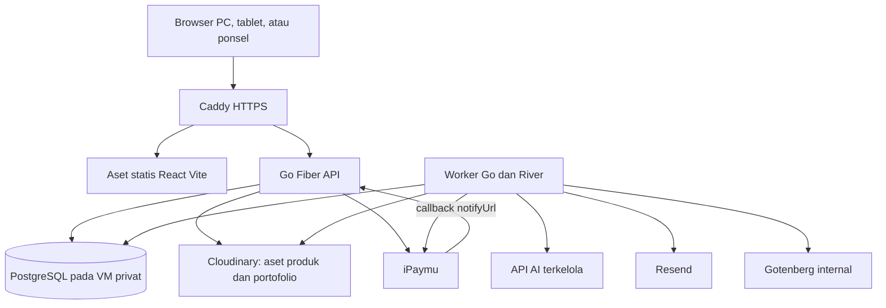

# Hurahopi — Arsitektur, Akses, dan Data

[Dokumentasi utama](../README.md).

Tanggal: 26 Oktober 2026. Status: baseline implementasi; penyedia dan kebijakan terbuka mengikuti decisions.md.

Bagian dari [rencana pengembangan](plan.md). [Daftar keputusan](decisions.md) mencatat status persetujuan; aturan produk ada di [PRD](prd.md). Parameter uji tetap memerlukan evaluasi pendidik.

## Arsitektur dan Teknologi

### Stack Inti dan Layanan Pendukung

**Ditetapkan — D1/D6, 25 Oktober 2026.** Pemilik produk mendelegasikan pemilihan teknis berdasarkan riset open source. Tabel berikut menjadi acuan tunggal pilihan teknologi. Tahap pemasangan berbeda dari status keputusan: modul M3 sudah dipilih, tetapi dipasang ketika fiturnya dikerjakan. Versi paket dan image dikunci setelah uji kompatibilitas pada milestone pemiliknya; pemilihan teknologi tidak menyatakan implementasi atau integrasinya telah lulus.

| Area | Pilihan | Mulai dipakai |
| --- | --- | --- |
| Frontend | React, Vite, TypeScript; scaffold resmi `create-vite` React TypeScript | S01 |
| Backend | Go, Fiber; scaffold minimum dari [Go Blueprint](https://github.com/Melkeydev/go-blueprint) | S01 |
| Database dan akses data | PostgreSQL dikelola sendiri; pgx/pgxpool; query SQL eksplisit | S01–S02 |
| Migrasi | [Goose](https://github.com/pressly/goose), berkas SQL berversi | S02 |
| UI bersama | shadcn/ui varian Base UI, Tailwind CSS, token Hurahopi | S01–S04 |
| Routing dan server state | TanStack Router; TanStack Query; satu pola navigasi untuk seluruh aplikasi | S01–S04 |
| Dashboard orang tua | Layout/tabel terpilih dari [Satnaing Shadcn Admin](https://github.com/satnaing/shadcn-admin), disesuaikan dengan token/primitive bersama | S04–S07 |
| Panel admin | [Shadcn Admin Kit](https://github.com/marmelab/shadcn-admin-kit), ra-core, adapter `ra-router-tanstack`; data/auth provider menuju Go API | S09 |
| Kontrak dan client HTTP | OpenAPI; [openapi-typescript](https://github.com/openapi-ts/openapi-typescript) menghasilkan tipe; openapi-fetch menjadi client bertipe | S02 |
| Login Google | [Go OAuth2](https://github.com/golang/oauth2) dan [go-oidc](https://github.com/coreos/go-oidc); sesi aplikasi tersimpan di PostgreSQL | S03 |
| Magic link, PIN, izin, lease | Domain Hurahopi memakai primitive kriptografi/library standar; tidak menulis protokol OAuth sendiri | S03–S06 |
| Aktivitas inti | Renderer React/DOM Hurahopi; ketuk/keyboard sebagai dasar; [dnd-kit](https://github.com/clauderic/dnd-kit) untuk drag pada aktivitas yang memerlukannya | S04; drag saat templat terkait dikerjakan |
| Gambar/kanvas | Konva dan [react-konva](https://github.com/konvajs/react-konva), dimuat saat digunakan | M3 |
| Antrean | [River](https://github.com/riverqueue/river) dengan PostgreSQL | Saat job tahan restart pertama dibutuhkan, paling lambat M3 |
| Media | Cloudinary, delivery authenticated untuk portofolio | Pembuktian sintetis S09; fitur M3 |
| PDF laporan | [Gotenberg](https://github.com/gotenberg/gotenberg) melalui worker River, service Docker internal | M3 |
| Email transaksional | [Resend melalui SDK Go resmi](https://resend.com/docs/send-with-go); fake sender lokal/test | Adapter dan pengujian S03; pengiriman nyata setelah domain/akun siap |
| Pemantauan kesalahan | Sentry melalui SDK resmi Go/React; log terstruktur Go `slog` | Log S01; Sentry staging sebelum uji eksternal |
| Pembayaran | iPaymu Redirect Payment; adapter HTTP Go | M4 |
| Deployment | VM, Docker Compose, Caddy; frontend/API pada origin yang sama | Compose lokal S01; staging/produksi M4 |
| Pengujian | Go testing, PostgreSQL integrasi, Vitest, Playwright | Sesuai cerita mulai S01 |

**D5 tetap terbuka:** penyedia/model/akun AI dipilih melalui evaluasi produksi yang terpisah. Pengembangan awal memakai fake provider dan data sintetis; narasi laporan memakai templat berbukti. Persyaratan akun merchant iPaymu, domain Resend, DSN Sentry, serta kesiapan media adalah pemeriksaan integrasi/operasional, bukan pilihan teknologi yang perlu diputuskan ulang.

### Pemakaian Ulang dan Batas Modul

Scaffold Go Blueprint dipakai sekali untuk backend: server, konfigurasi, health/readiness, dan pola container. Hasil generate ditempatkan sementara, dicatat versi/commit asalnya, lalu disesuaikan ke struktur `backend/` dan Fiber yang dipilih. Frontend memakai scaffold resmi Vite agar tidak membawa frontend kedua dari generator. Tidak membawa HTMX, ORM, Redis, S3/MinIO, atau auth JWT aplikasi dari template. PostgreSQL sudah menangani sesi dan River, sedangkan Cloudinary menangani media. [Dokumentasi Go Blueprint](https://docs.go-blueprint.dev/) menjadi rujukan generator; hasilnya tetap harus dibangun dan diverifikasi pada S01.

Dashboard orang tua mengambil layout dan pola tabel Satnaing secara selektif. Semua primitive interaktif berasal dari shadcn/ui varian Base UI yang sama dengan Admin Kit; komponen sumber yang masih memakai primitive lain disesuaikan sebelum diimpor. Clerk, halaman demo, auth store demo, dan data contoh sumber tidak menjadi implementasi Hurahopi. Admin Kit hanya mengelola area `/admin`; adapter TanStack mengikuti [panduan resmi Admin Kit](https://marmelab.com/shadcn-admin-kit/docs/quick-start-guide/). Tidak menambah React Router sebagai router aplikasi kedua.

Data provider admin memanggil API Go melalui client bertipe yang sama dengan frontend lain. Ia menerjemahkan filter/paginasi dan galat ke format ra-core; aksi review/publish tetap operasi domain tersendiri. Auth provider membaca sesi backend dan permission terbaru, bukan memberikan izin dari state UI. Generic CRUD tidak boleh mengubah status publikasi atau melewati versi/review konten.

TanStack Query dipakai untuk data server; scope cache mencakup identitas/konteks keluarga, anak, dan kursus. Logout, pergantian konteks dewasa/anak, pencabutan izin, serta pergantian profil membatalkan request terkait dan membersihkan cache yang tidak lagi boleh dibaca. Data keluarga tidak dipersistenkan ke localStorage. Mutasi jawaban/pembayaran/transfer tidak diulang otomatis; recovery eksplisit memakai idempotency key yang sama. Client HTTP memakai cookie, CSRF, dan penanganan galat dari [spesifikasi teknis](technical-spec.md), bukan bearer token demo.

Renderer dua templat awal tetap kecil dan khusus Hurahopi: React/DOM dan interaksi ketuk. dnd-kit dipasang saat drag diperlukan, tanpa menghapus alternatif ketuk/keyboard. Konva/react-konva dipasang pada M3 untuk kanvas; state terstruktur dan hasil karya disimpan sesuai izin/retensi. Tidak memasang engine permainan, renderer LMS, atau BKT untuk menggantikan aturan deterministik 8/10.

Frontend memiliki tiga susunan layar: ringkasan pendamping, dunia Hopi anak, dan panel admin. Anak memakai beranda satu misi serta aktivitas fokus; komponen dashboard orang tua tidak menjadi kerangka layar permainan. Pendamping menyiapkan sesi/lease melalui area dewasa terlebih dahulu, lalu browser berpindah ke beranda anak dengan konteks terbatas. Rincian visual dan handoff ada di [UX](ux-spec.md#tata-letak-utama-anak); alur fitur ada di [activity diagram](../README.md#activity-diagram).

Goose berjalan sebagai proses migrasi terkontrol dengan kredensial migrasi, bukan pada startup setiap replica API. pgxpool menjadi pool aplikasi. OpenAPI TypeScript hanya menghasilkan deklarasi tipe; openapi-fetch adalah library client yang dikonfigurasi dengan tipe tersebut. Validasi request/response runtime dan otorisasi tetap tugas backend/pengujian kontrak. Rujukan: [Goose](https://github.com/pressly/goose) dan [openapi-fetch](https://openapi-ts.dev/openapi-fetch/).

PDF dibuat dari HTML/CSS dan aset yang disiapkan backend, kemudian dikirim worker ke Gotenberg pada jaringan internal. Gotenberg tidak menerima request publik atau URL arbitrer dari browser, tidak mengaktifkan hak akses, dan bukan tempat arsip laporan. Worker memeriksa izin/penghapusan sebelum menyimpan atau menyerahkan hasil; endpoint unduh tetap memeriksa sesi. Izin mengikuti PRD dan masa simpan berkas mengikuti D2; pilihan engine PDF sudah final. [Dokumentasi Gotenberg](https://gotenberg.dev/docs/getting-started/introduction) menjadi rujukan operasional converter.

Resend hanya mengirim email transaksional kepada orang dewasa; token login/undangan tidak ditulis ke log atau telemetry. Sentry mengirim error teknis yang telah disanitasi; session replay, screenshot, perekaman input, dan pengiriman PII otomatis dinonaktifkan. Tidak mengirim nama anak, jawaban, media, cookie, token, PIN, atau body request. Integrasi error memakai [SDK Go resmi](https://github.com/getsentry/sentry-go) dan SDK React resmi; periksa kompatibilitas versi saat integrasi. Resend dan Sentry adalah layanan terkelola yang dipilih; penggunaan SDK terbuka tidak berarti layanan hosted-nya merupakan bagian deployment open source Hurahopi.

### Asal Kode, Lisensi, dan Pemeliharaan

Arah visual, token, dan alasan komposisi ketiga area ada pada [desain antarmuka](desain.md); alur serta izin tetap mengikuti UX/PRD. Skill proyek dirutekan melalui [AGENTS.md](../AGENTS.md), dan snapshot anti-slop beserta lisensinya dicatat pada [third-party notices](../THIRD_PARTY_NOTICES.md).

| Sumber yang dipakai | Bentuk pemakaian | Lisensi kode yang diperiksa saat riset |
| --- | --- | --- |
| Go Blueprint, Satnaing Shadcn Admin, Shadcn Admin Kit | Scaffold atau komponen terpilih; perubahan lokal menjadi tanggung jawab Hurahopi | MIT; pertahankan notice asal pada bagian yang diambil |
| dnd-kit, react-konva, Goose, OpenAPI TypeScript/Fetch, Gotenberg | Library/tool/service sesuai tabel stack | MIT untuk repo tersebut; dependensi serta aset distribusi diperiksa terpisah |
| Go OAuth2 dan go-oidc | Library protokol identitas | BSD-3-Clause dan Apache-2.0 |
| River | Library queue | MPL-2.0; catat ketentuan untuk berkas upstream yang dimodifikasi/didistribusikan; fitur Pro tidak menjadi dependensi |

Saat mengimpor, catat sumber, versi/tag/commit, file yang diambil, lisensi, dan perubahan lokal pada catatan lisensi terpusat `THIRD_PARTY_NOTICES.md` ketika impor pertama dilakukan; tautkan dari README utama tanpa membuat README modul. Ini bagian S01/S04/S09 sesuai sumber yang dipakai. Lockfile, `go.mod`/`go.sum`, dan tag/digest image mengunci hasil yang telah diuji. Jangan memakai referensi `latest` mengambang pada deployment. Lisensi library tidak otomatis mencakup logo, gambar, audio, font, atau konten pendidikan pihak lain.

Hasil riset terbuka yang relevan telah diringkas menjadi keputusan D1/D6. Kandidat seperti Perseus, OATutor, GCompris, Kolibri, H5P, serta boilerplate backend lengkap tidak menjadi dependensi atau basis fork. Pola pembelajaran umum boleh menjadi bahan diskusi pendidik; implementasi, konten, dan aset Hurahopi tetap mengikuti spesifikasi serta hak penggunaan yang diperiksa. Mengubah pilihan teknologi setelah implementasi memerlukan alasan konkret dan pembaruan dokumen terkait.

### Susunan Aplikasi

Satu codebase backend dengan modul sesuai fungsi produk dan dua proses terpisah: **API** dan **worker**. API menangani permintaan pengguna. Worker memproses transkripsi, analisis gambar, pembuatan draf soal, pembuatan PDF laporan, email, laporan mingguan, rekonsiliasi pembayaran, pengingat masa akses, dan penghapusan data.

Frontend dan API berada pada origin yang sama. Caddy menyajikan aset statis dan meneruskan `/api/v1` ke Fiber. Node.js digunakan pada proses build frontend; produksi menyajikan hasil build sesuai [panduan deployment Vite](https://vite.dev/guide/static-deploy.html).

API menambahkan pekerjaan ke PostgreSQL dan worker mengambilnya melalui River. Draf soal dari AI masuk ke antrean peninjauan, bukan langsung ke anak.

### Data dan Kontrak API

Entitas utama: keluarga, pengguna (pemilik dan pengasuh), undangan dan izin pengasuh, profil anak, persetujuan, bab, tingkat, keterampilan, templat aktivitas, versi aktivitas, draf soal AI dan hasil peninjauan, tes penempatan, sesi, percobaan, media, pengamatan, status penguasaan, laporan dan ekspor PDF, koleksi, worksheet, soal olimpiade, paket, pesanan, segmen akses, dan sesi perangkat.

Operasi API: pengelolaan akun, profil, dan pengasuh; tes penempatan; mulai atau lanjut sesi; pengambilan aktivitas; pengiriman jawaban dan media; laporan dan ekspor PDF; portofolio; unduhan worksheet; latihan olimpiade; checkout; callback pembayaran; pengelolaan perangkat aktif; serta pengelolaan konten dan draf soal.

Layanan review/publish minimum dan penyimpanan peran/persetujuan dibuat S04; panel editorial lengkap masuk S09. Review mencakup hash definisi dan versi aset yang immutable, sehingga pergantian gambar/audio tidak dapat memakai persetujuan lama.

Kontrak memakai OpenAPI; openapi-typescript menghasilkan tipe TypeScript yang digunakan client openapi-fetch (**Ditetapkan — D6**). Status analisis dan status ekspor PDF diambil melalui polling pada versi pertama. Pengiriman ulang jawaban harus idempoten: satu pengiriman logis tetap menghasilkan satu pencatatan progres.

Model Fase 1 berisi 59 tabel yang ditambahkan sesuai kebutuhan; S02–S03 hanya memakai 11 tabel. Penyajian/hasil soal berbagi attempt_id, jawaban terpisah pada responses, dan data klaim/varian dimiliki snapshot/media. Izin pengasuh/undangan memakai satu child_permissions, sedangkan peran admin tetap berupa users.roles dengan audit perubahan.

Model data mengacu pada [ERD dan kamus data](database/design.md): satu PostgreSQL, enam kelompok domain, tabel/kolom `snake_case`, PK entitas tunggal + `_id`. Metadata library Goose/River dikelola terpisah dari model domain. Diagram dan kamus diperbarui bersama model metadata; migrasi diterapkan bertahap sesuai delivery.

### Kesiapan Fase 2

Agar penambahan bahasa dan mata pelajaran tidak memerlukan penulisan ulang, Fase 1 menyiapkan hal berikut tanpa membangun fitur Fase 2 (**Rekomendasi**):

- Entitas **mata pelajaran/kursus** dan **bahasa pengantar** (locale) pada konten, dengan satu kursus (matematika) dan satu locale (Indonesia) pada Fase 1.
- Seluruh teks antarmuka dan narasi audio disimpan sebagai sumber yang dapat diterjemahkan, bukan ditulis langsung di komponen.
- Templat permainan dan pembuat soal terpisah dari teks, sehingga materi yang sama dapat disajikan dalam bahasa Inggris. Alur soal AI dapat dipakai ulang untuk bahasa lain dengan peninjauan pendidik bahasa terkait.
- Hak akses mengacu pada kursus, bukan hanya pada "langganan Hurahopi", sehingga paket Fase 2 dapat berupa gabungan atau per mata pelajaran (D11).
- Peta Belajar disimpan per kursus.

### Antrean dan Keandalan Pemrosesan

[River](https://riverqueue.com/docs) menggunakan PostgreSQL sebagai target database utama. Penyimpanan jawaban dan pembuatan pekerjaan dilakukan dalam [transaksi yang sama](https://riverqueue.com/docs/transactional-enqueueing).

Pekerjaan dapat dijalankan lebih dari sekali. Hasil logis analisis, draf soal, dan perubahan akses diberi identitas unik. Panggilan eksternal menggunakan idempotency key jika didukung; status permintaan yang ambigu dicatat untuk rekonsiliasi. Lihat [panduan worker River](https://riverqueue.com/docs/reliable-workers). Worker menerima ID referensi, mengambil data yang diperlukan, dan menggunakan context serta timeout sendiri. Context Fiber tetap berada dalam masa hidup handler, sesuai [panduan context Fiber](https://docs.gofiber.io/guide/go-context/).

## Akses, Media, dan Siklus Hidup Data

### Autentikasi dan Otorisasi

Baseline implementasi akses (**Ditetapkan — D6/D9/D14**):

- Backend Go menangani callback Google, verifikasi identitas, tautan email sekali pakai dengan masa berlaku, serta pembuatan dan pencabutan sesi.
- Sesi disimpan di PostgreSQL dengan cookie `HttpOnly`, `Secure`, dan `SameSite`. Operasi perubahan data memiliki perlindungan CSRF.
- Pengasuh diundang melalui tautan email sekali pakai oleh pemilik akun, lalu masuk dengan identitasnya sendiri. Izin pengasuh diperiksa pada backend per profil anak untuk setiap operasi ([hak orang tua dan pengasuh](prd.md#pengalaman-orang-tua-dan-pengasuh)), dan pencabutan akses keluarga/profil berlaku pada permintaan berikutnya dengan pemeriksaan membership terbaru serta pencabutan lease belajar terkait. Login pengasuh pada keluarga lain tidak ikut dicabut.
- Mode anak dibatasi pada profil dan sesi belajar. Verifikasi PIN area orang tua dicatat pada sesi backend; autentikasi akun tetap menjadi dasar akses.
- Browser mengakses data melalui API. Otorisasi memeriksa kepemilikan keluarga, izin pengguna atas profil anak, hak akses paket, dan peran admin pada setiap operasi serta query terkait.
- API dan worker memakai akun database dengan hak sesuai tugas. Database produksi hanya tersedia melalui jaringan privat dan jalur administrasi terbatas.
- Kunci jawaban, kredensial layanan, dan API secret hanya berada di server. Media serta kredensial tidak dimasukkan ke log atau payload antrean.

### Sesi Belajar dan Perangkat

**Ditetapkan — D9, menggantikan seluruh ketentuan satu perangkat per akun pada draf 24 Oktober 2026.** Autentikasi orang tua/pengasuh dapat aktif pada beberapa perangkat. Pembatasan berlaku pada anak: satu sesi belajar aktif dan satu lease perangkat aktif per anak, termasuk ketika pengguna yang mendampingi berbeda. Dua anak dengan hak akses masing-masing boleh belajar bersamaan.

Bedakan tiga objek:

- **Sesi autentikasi** mengidentifikasi orang dewasa pada browser. Login perangkat baru tidak otomatis mencabut sesi lain. Logout, pencabutan manual, dan perubahan keamanan tetap dapat mencabutnya.
- **Sesi belajar** menyimpan rencana aktivitas, percobaan, dan progres satu anak. Status `active`, `paused`, `completed`, atau `ended`; maksimal satu sesi `active`/`paused` yang dapat dilanjutkan per anak.
- **Lease belajar** memberi satu browser izin menulis ke sesi belajar tersebut. Token opaque disimpan dalam cookie HttpOnly terpisah; backend menyimpan hash, generasi, dan riwayat lease; counter `children.lease_generation` tetap meningkat walau riwayat lama dibersihkan; satu baris aktif per anak, baris sebelumnya dicabut dan dipertahankan untuk audit/recovery. Tidak ada token otorisasi dalam localStorage atau query URL.

Alur pemindahan:

1. Mulai/lanjut memeriksa autentikasi, konteks dewasa/PIN, izin profil, persetujuan, dan hak belajar. Bila browser yang sama memiliki lease valid, lanjutkan instans lama tanpa membuat sesi baru.
2. Bila ada lease milik browser lain, jawab `409 LEARNING_ACTIVE_ELSEWHERE`. Respons menyediakan identitas sesi dan generasi yang akan dipindahkan, tanpa secret perangkat lain. Belum ada pencabutan pada langkah ini.
3. Tampilkan konfirmasi di area dewasa. Konfirmasi memerlukan PIN/verifikasi dewasa yang masih berlaku serta generasi yang dilihat pengguna. Server mengunci baris anak/lease, memeriksa ulang izin dan akses, mencabut lease lama, lalu menerbitkan lease baru dalam satu transaksi. Generasi berubah di sela konfirmasi menghasilkan `409 LEASE_CHANGED`; jangan memindahkan sesi terbaru secara diam-diam.
4. Pertahankan ID sesi belajar, rencana, dan instans yang sedang dikerjakan; progres tersimpan tidak hilang. Token browser lama tidak dapat menulis lagi. Sesi autentikasi orang tua di perangkat tersebut tetap ada.
5. Perangkat lama mengetahui pencabutan pada permintaan berikutnya/polling saat aktif. Tampilkan pesan bahwa sesi belajar dipindahkan; kembali ke area dewasa tetap memerlukan PIN. Pemeriksaan berkala tidak memerlukan WebSocket.
6. Catat pemindahan dan pencabutan. Frekuensi yang tidak wajar dapat ditinjau; tidak ada pemblokiran otomatis pada baseline awal.

Mutasi browser mengunci auth_session pemanggil lebih dahulu, lalu anak, sesi/lease, dan instans. Partial unique index per auth_session membatasi satu lease aktif browser, termasuk antar-tab. Mulai profil lain memerlukan pause eksplisit; transfer tidak mengubah auth_session perangkat lama di bawah lock child.

Serialisasi pemindahan, pengiriman jawaban, penghentian sesi, dan pencabutan pengasuh terhadap baris lease/anak yang sama. Jika jawaban lama commit sebelum pemindahan, hasilnya dipertahankan; jika pemindahan commit lebih dahulu, jawaban lama ditolak. Pemeriksaan lease dilakukan sebelum membaca cache idempotensi agar retry dari perangkat tercabut tetap ditolak.

Pencabutan karena pemindahan/izin berbeda dari penutupan normal karena selesai/pause. Pemilik token yang sama dapat membaca hasil operasi yang sudah commit setelah penutupan normal, tanpa izin menulis baru. Pemulihan respons penerbitan cookie yang hilang hanya boleh menerbitkan ulang lease yang masih dimiliki sesi browser tersebut. Detail recovery dan otorisasi ada di [spesifikasi teknis](technical-spec.md#transaksi-yang-wajib-atomik).

Latihan membekukan rencana. Pada penempatan, yang dibekukan adalah versi aturan/batas serta instans yang sudah disajikan; pemilihan probe berikutnya tetap mengikuti hasil.

Pause melepaskan lease dan mempertahankan sesi yang dapat dilanjutkan. Resume menerbitkan lease baru setelah memeriksa ulang hak belajar. Sesi berjalan saat masa akses habis boleh menyelesaikan rencana aktivitas yang telah dibekukan; pause, idle, atau sesi selesai mengakhiri pengecualian itu. Menambah putaran baru memerlukan hak belajar aktif. Default teknis idle untuk prototipe: 15 menit tanpa interaksi, diperiksa server dan dapat dikonfigurasi; polling bukan interaksi belajar.

### Media dan Pengelolaan Cloudinary

Cloudinary merupakan pilihan yang telah ditetapkan. Mekanisme akses berikut merupakan rancangan yang direkomendasikan.

| Aspek | Rancangan |
| --- | --- |
| Pemisahan aset | Bedakan aset produk (gambar, audio, video pembelajaran) dari portofolio anak |
| Aset produk | Disajikan melalui Cloudinary; soal dan kunci jawaban tidak berada pada aset, melainkan diperiksa di server |
| PDF worksheet dan latihan olimpiade | Disajikan melalui endpoint backend setelah pemeriksaan hak akses paket; tidak menggunakan URL publik permanen |
| Proteksi portofolio | Delivery type `authenticated` untuk file asli dan turunannya |
| Jenis resource | Gambar menggunakan `image`; rekaman suara menggunakan `video` |
| Unggahan | Melalui backend Go setelah pemeriksaan kepemilikan atau izin, jenis file, ukuran, dan durasi |
| Tampilan dan pemutaran | Melalui endpoint backend yang memeriksa sesi, izin, dan kepemilikan, mendukung rentang byte untuk audio, dan tidak menggunakan cache publik |
| Varian media | Thumbnail atau varian portofolio disiapkan melalui eager transformations dengan akses authenticated |
| Metadata | PostgreSQL menyimpan identitas aset, jenis resource, delivery type, format, versi, profil anak, dan aktivitas terkait |
| Analisis AI | Worker mengambil media menggunakan kredensial backend berdasarkan ID media internal |

Cloudinary melindungi file asli dan turunannya pada delivery type `authenticated`; turunan aset `private` dapat tersedia publik pada konfigurasi default. Lihat [kontrol akses media](https://cloudinary.com/documentation/control_access_to_media) dan [pengaturan upload](https://cloudinary.com/documentation/upload_parameters).

Backend mengalirkan portofolio tanpa mengekspos URL delivery bertanda tangan kepada browser. Dampak bandwidth dan koneksinya diukur dalam pengujian beban. Pengiriman langsung menggunakan token akses kedaluwarsa dapat dievaluasi kemudian sesuai kebutuhan dan fitur akun. Signature delivery biasa tidak diperlakukan sebagai jaminan kedaluwarsa akses.

### Persetujuan, Retensi, dan Penghapusan

Data yang dikumpulkan dibatasi pada nama panggilan, usia, avatar, progres belajar, serta gambar dan rekaman suara anak. Persetujuan orang tua diminta secara terpisah untuk penggunaan AI, pemrosesan media, dan penyimpanan portofolio; setiap persetujuan dapat ditarik, dengan konsekuensi yang dijelaskan (misalnya jawaban suara dinonaktifkan sehingga anak memakai ketuk-pilih). Pengelolaan data pribadi anak mengacu pada Undang-Undang Pelindungan Data Pribadi (UU No. 27 Tahun 2022); kebijakan privasi dan persetujuan sebaiknya ditinjau penasihat hukum sebelum peluncuran, terutama karena rekaman suara dan gambar anak diproses penyedia AI.

**Status kebijakan retensi: Terbuka — D2.** Rekomendasi awal mempertahankan portofolio selama akun tersedia, sampai orang tua menghapus media atau akun. Retensi transkrip, hasil analisis, ekspor PDF, akun tidak aktif, cadangan, dan catatan transaksi perlu ditetapkan secara terpisah. Rekomendasi untuk transkrip: simpan hasil teks singkat yang diperlukan sebagai bukti dan tidak menyimpan audio jawaban kecuali orang tua menyimpannya di portofolio.

Alur penghapusan yang direkomendasikan menutup akses aplikasi terlebih dahulu, membatalkan pekerjaan terkait (termasuk ekspor PDF), lalu menghapus media Cloudinary serta meminta invalidasi CDN. Kegagalan dijadwalkan ulang dan dipantau. Transkrip atau pengamatan turunan yang relevan dihapus, dan ringkasan yang terdampak dibuat ulang. Pemulihan cadangan memeriksa catatan penghapusan agar data yang telah dihapus tidak muncul kembali. Jadwal penghapusan cadangan mengikuti kebijakan retensi yang disepakati.
