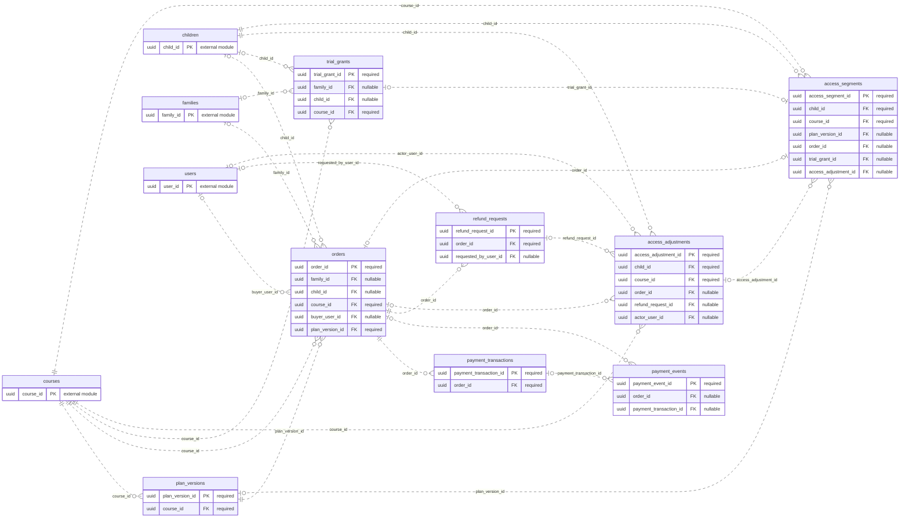

# ERD — Paket dan Pembayaran

Acuan metadata: [schema.json](schema.json). Perbarui model, diagram, dan kamus data bersama ketika rancangan berubah.

[Dokumentasi utama](../../README.md#database) · [Aturan desain](design.md) · [Kamus data lengkap](data-dictionary.md)

Diagram menampilkan PK/FK. Kotak `external module` hanya menunjukkan PK tabel modul lain. Garis mencakup seluruh FK tunggal milik modul ini; FK komposit dan batasan unik bersyarat dirinci di kamus data. Kardinalitas adalah batas struktural FK, bukan jaminan bahwa proses bisnis sudah selesai.

## Tabel dan waktu implementasi

| Tabel | Primary key | Mulai | Tujuan |
| --- | --- | --- | --- |
| [plan_versions](data-dictionary.md#plan_versions) | `plan_version_id` | M4 | Versi harga, durasi dan fitur paket yang dibekukan. |
| [orders](data-dictionary.md#orders) | `order_id` | M4 | Pesanan satu anak/kursus dan satu versi paket. |
| [payment_transactions](data-dictionary.md#payment_transactions) | `payment_transaction_id` | M4 | Percobaan transaksi gateway untuk suatu order. |
| [payment_events](data-dictionary.md#payment_events) | `payment_event_id` | M4 | Jejak callback/poll/reconciliation dengan data minimum. |
| [trial_grants](data-dictionary.md#trial_grants) | `trial_grant_id` | M4 | Ledger penerima trial yang tidak direset dengan menghapus/mengganti profil. |
| [refund_requests](data-dictionary.md#refund_requests) | `refund_request_id` | M4 | Kasus refund manual melalui dukungan/penyedia sesuai D7. |
| [access_adjustments](data-dictionary.md#access_adjustments) | `access_adjustment_id` | M4 | Catatan penyesuaian akses oleh operasional, termasuk akibat refund. |
| [access_segments](data-dictionary.md#access_segments) | `access_segment_id` | M4 | Hak belajar/fitur pada interval waktu satu anak/kursus. |
