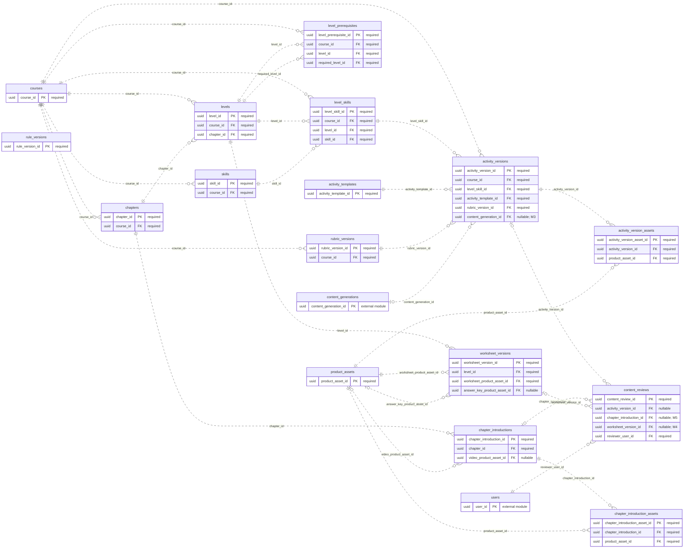

# ERD — Kurikulum dan Konten

Acuan metadata: [schema.json](schema.json). Perbarui model, diagram, dan kamus data bersama ketika rancangan berubah.

[Dokumentasi utama](../../README.md#database) · [Aturan desain](design.md) · [Kamus data lengkap](data-dictionary.md)

Diagram menampilkan PK/FK. Kotak `external module` hanya menunjukkan PK tabel modul lain. Garis mencakup seluruh FK tunggal milik modul ini; FK komposit dan batasan unik bersyarat dirinci di kamus data. Kardinalitas adalah batas struktural FK, bukan jaminan bahwa proses bisnis sudah selesai.

## Tabel dan waktu implementasi

| Tabel | Primary key | Mulai | Tujuan |
| --- | --- | --- | --- |
| [courses](data-dictionary.md#courses) | `course_id` | S02 | Mata pelajaran; Fase 1 berisi math. |
| [chapters](data-dictionary.md#chapters) | `chapter_id` | S04 | Bab dalam suatu kursus. |
| [levels](data-dictionary.md#levels) | `level_id` | S04 | Tingkat dalam satu bab. |
| [skills](data-dictionary.md#skills) | `skill_id` | S04 | Target keterampilan matematika yang stabil. |
| [level_skills](data-dictionary.md#level_skills) | `level_skill_id` | S04 | Relasi tingkat dengan keterampilan; satu keterampilan dapat dilatih pada beberapa tingkat. |
| [level_prerequisites](data-dictionary.md#level_prerequisites) | `level_prerequisite_id` | S04 | Tingkat prasyarat, termasuk antar bab dalam satu kursus. |
| [rule_versions](data-dictionary.md#rule_versions) | `rule_version_id` | S05 | Konfigurasi aturan penempatan, mastery, atau ringkasan laporan yang dibekukan. |
| [rubric_versions](data-dictionary.md#rubric_versions) | `rubric_version_id` | S04 | Rubrik objektif/observasi berversi. |
| [activity_templates](data-dictionary.md#activity_templates) | `activity_template_id` | S04 | Versi renderer/generator dan schema parameter suatu templat. |
| [product_assets](data-dictionary.md#product_assets) | `product_asset_id` | S04 | Aset produk orisinal/berizin; terpisah dari media pribadi anak. |
| [activity_versions](data-dictionary.md#activity_versions) | `activity_version_id` | S04 | Konten, parameter, kunci server dan rubrik pada suatu revisi/versi. |
| [activity_version_assets](data-dictionary.md#activity_version_assets) | `activity_version_asset_id` | S04 | Aset produk yang dirujuk versi aktivitas. |
| [chapter_introductions](data-dictionary.md#chapter_introductions) | `chapter_introduction_id` | M5 | Versi pengantar bab interaktif/video opsional. |
| [chapter_introduction_assets](data-dictionary.md#chapter_introduction_assets) | `chapter_introduction_asset_id` | M5 | Aset produk yang dirujuk layar pengantar bab. |
| [worksheet_versions](data-dictionary.md#worksheet_versions) | `worksheet_version_id` | M4 | Versi PDF worksheet dan kunci orang tua. |
| [content_reviews](data-dictionary.md#content_reviews) | `content_review_id` | S04 | Persetujuan/penolakan manusia terhadap tepat satu target konten. |
