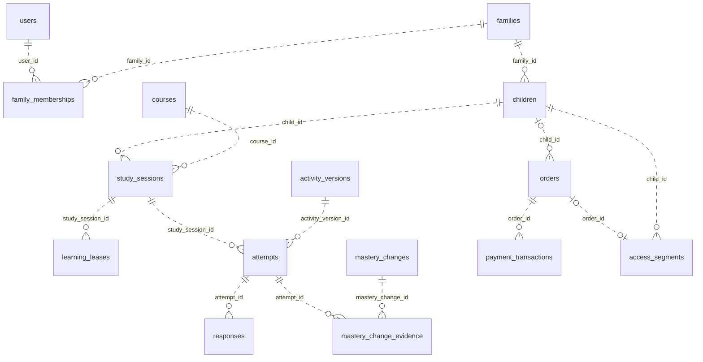

# Hurahopi — Rancangan Database dan ERD

Baseline: 25 Oktober 2026; review isi diperbarui 26 Oktober 2026. Status: **rancangan Fase 1, belum migrasi SQL**. Konvensi nama mengikuti instruksi pemilik produk pada D15. Relasi dan batasan di sini menerjemahkan [PRD](../prd.md), [pembelajaran](../learning-spec.md), serta [arsitektur](../architecture.md); kebijakan yang masih terbuka tetap mengikuti [daftar keputusan](../decisions.md).

Daftar seluruh dokumen, ERD, dan alat pemeliharaan ada di [README utama](../../README.md#database). Bagian ini menetapkan aturan desain database; rincian kolom berada di [kamus data](data-dictionary.md).

Enam modul mencakup 59 tabel domain seluruh Fase 1. Modul adalah pembagian tanggung jawab dalam satu PostgreSQL, bukan layanan/database terpisah. Implementasi tetap bertahap mengikuti milestone.

## Gambaran utama

Garis putus menunjukkan relasi non-identifying: setiap tabel memiliki PK sendiri. `||` berarti satu, `|o`/`o|` berarti nol atau satu, `o{` berarti nol atau banyak. Nullable FK menjelaskan hubungan opsional, bukan izin membuat pesanan tanpa penerima; API tetap memiliki prasyarat lebih ketat. Notasi mengikuti [dokumentasi ERD Mermaid](https://mermaid.js.org/syntax/entityRelationshipDiagram.html).

## Konvensi nama dan tipe

| Bagian | Ketentuan | Contoh |
| --- | --- | --- |
| Tabel | `snake_case`, bentuk jamak; nama domain yang tidak lazim dijamakkan tetap alami | `users`, `attempts`, `chapter_progress` |
| Kolom | `snake_case`, arti jelas | `instruction`, `created_at`, `first_response_correct` |
| Primary key | Nama entitas **tunggal** + `_id`; UUID, NOT NULL | `users.user_id`, `families.family_id`, `children.child_id` |
| PK tabel penghubung | PK sendiri, ditambah UNIQUE pasangan bisnis | `family_memberships.family_membership_id` dan UNIQUE `(family_id, user_id)` |
| Foreign key | Sama dengan PK tujuan; boleh awalan peran agar tidak ambigu | `child_id`, `requested_by_user_id`, `from_level_id`, `to_level_id` |
| Kode domain | Cukup `code` pada tabel yang konteksnya jelas; bukan primary key | `courses.code`, `activity_templates.code` |
| Waktu | `timestamptz`, akhiran `_at`; API ISO 8601 UTC | `created_at`, `completed_at`, `expires_at` |
| Penanda boolean | Kata bermakna boolean; NOT NULL kecuali hasil belum tersedia | `is_required`, `can_learn`, `was_assisted` |
| Rupiah | `bigint`, tidak memakai float; mata uang `IDR` | `price`, `amount_due` |
| JSON terstruktur | `jsonb`, validasi schema dan batas ukuran di server | `parameters`, `grading_snapshot`, `answer` |
| Constraint/index | `snake_case`, maksimum 63 byte; nama pendek yang tetap bermakna | `pk_users`, `fk_children_family`, `uq_active_lease_child` |

Nama field memakai konteks tabel: `children.avatar`, `users.email`, `family_memberships.role`, `identities.provider`, `activity_versions.locale`, serta `plan_versions.price`/`currency`. Jangan mengulang nama tabel atau menambahkan akhiran jenis data tanpa kebutuhan. Nama PK/FK, hash/token terenkripsi, timestamp, dan unit seperti `age_years`/`duration_ms` tetap eksplisit. `code` lokal disajikan sebagai selector yang jelas pada API, misalnya `course` dan `template`.

Nama mengikuti entitas dengan kata sesedikit yang tetap jelas. `rule_versions`, `child_permissions`, dan `content_generations` cukup menjelaskan tanggung jawabnya. `auth_sessions`/`study_sessions` serta `product_assets`/`media_assets` tetap dibedakan karena menyimpan objek dengan izin/siklus hidup berbeda. Tabel penghubung boleh memakai nama lebih panjang bila itu menjelaskan relasi yang sebenarnya.

Personalisasi dekorasi dan preferensi adalah atribut `children`, ditambahkan M3. Tidak ada tabel profil tambahan untuk atribut satu-ke-satu dengan siklus hidup yang sama; pilihan hadiah tetap memakai FK komposit ke grant milik anak.

Seluruh tabel aplikasi memakai schema `public`. UUID diterbitkan server; pilihan generator dikunci pada S02. Jangan menerima UUID klien sebagai bukti kepemilikan. `study_session_event_id` boleh disiapkan klien untuk deduplikasi event, tetapi konteks dan isinya tetap divalidasi server. Semua tabel memiliki `created_at DEFAULT now()`; `updated_at` diperbarui eksplisit pada perubahan. Nilai default lain ditetapkan per migrasi; jangan memberi default untuk hasil penilaian yang belum tersedia.

Nama identitas resource pada JSON/OpenAPI mengikuti kolom: `study_session_id`, `attempt_id`, `activity_version_id`. Jangan menyederhanakannya menjadi `id`, `session_id`, atau `instance_id`. `request_id` adalah korelasi HTTP, `option_id` adalah key lokal dalam satu soal, dan `provider_transaction_id` adalah identitas eksternal; ketiganya tidak menyatakan FK domain. Adapter admin memetakan `activity_version_id` menjadi `record.id` hanya pada antarmuka ra-core, lalu menerjemahkannya kembali saat memanggil API.

**Batas metadata library:** aturan PK ini berlaku pada tabel domain Hurahopi. Tabel internal Goose/River dikelola migrasi resmi library dan mempertahankan nama/tipe kolomnya. Jangan mengganti kolom internal SDK demi konvensi domain. Metadata tersebut tidak termasuk 59 tabel ini; catat tabel/schema yang dibuat saat integrasi. River memiliki [migrasi resminya sendiri](https://riverqueue.com/docs/migrations). `processing_tasks.river_job_id` hanya korelasi SDK, bukan FK yang membuat riwayat domain bergantung pada retensi antrean.

## Batas model dan alasan tabel

59 tabel adalah rancangan seluruh Fase 1, bukan target jumlah minimum atau syarat bootstrap. S02–S03 memakai **11 tabel**: `courses`, `users`, `identities`, `families`, `family_memberships`, `children`, `auth_sessions`, `login_tokens`, `oauth_login_states`, `consent_events`, dan `audit_events`. S04–S07 menambahkan **26 tabel** kurikulum/belajar; S09 membuktikan **1 tabel** media sintetis. **21 tabel** lain baru masuk M3–M5 untuk pengasuh, media/laporan/AI, komersial/penghapusan, dan pengantar bab. Kolom bertanda introduced_in juga menunggu milestone-nya.

Tabel dipertahankan ketika mempunyai identitas/relasi, transaksi, atau riwayat sendiri. Nilai yang hanya dimiliki satu induk tidak selalu memerlukan tabel dan PK baru:

| Data | Bentuk yang digunakan | Alasan |
| --- | --- | --- |
| Peran global admin | `users.roles` | Tiga nilai tetap editor/reviewer/operator; perubahan diaudit, default kosong, tanpa katalog role dinamis |
| Izin undangan dan pengasuh | `child_permissions` | Struktur izin sama; tepat satu pemilik undangan atau membership; row undangan tidak memberi hak efektif |
| Seri aktivitas | `activity_versions` dengan `(course_id, code, locale, version)` | Tidak ada kebutuhan mereferensikan identitas aktivitas tanpa versi |
| Soal yang disajikan dan hasilnya | `attempts` dengan banyak `responses` | Satu penyajian menghasilkan satu hasil logis; satu PK cukup untuk render, penilaian, hadiah, dan bukti |
| Varian media | `media_assets.variants` | Daftar milik original, tanpa lifecycle/izin domain sendiri; key provider tetap dicatat untuk penghapusan |
| Klaim laporan | `report_snapshots.claims`, bukti pada `report_evidence` | Klaim dimiliki dokumen immutable; UUID bukti tetap FK relasional, bukan disisipkan ke JSON |
| Seri paket | `plan_versions` dengan `(course_id, code, version)` | Versi sudah membekukan penawaran lengkap; checkout memilih satu versi aktif |

Array roles berisi nilai konfigurasi tetap, bukan daftar FK; gunakan [operator array PostgreSQL](https://www.postgresql.org/docs/current/functions-array.html) untuk membatasi nilainya. Claims/variants memakai dokumen JSON yang dimiliki induk dengan validasi shape/key di server, sesuai [tipe JSON PostgreSQL](https://www.postgresql.org/docs/current/datatype-json.html). Jangan memindahkan hubungan anak, pembayaran, respons, atau bukti ke JSON demi mengurangi angka tabel.

59 bukan kuota yang harus dipertahankan. Tabel fitur yang belum dikerjakan ditinjau lagi pada milestone-nya; tambahan tabel memerlukan kebutuhan relasi/riwayat yang nyata. Jangan menambah katalog status, mata uang, avatar, provider, atau role dinamis untuk nilai tetap Fase 1.

## Relasi dan integritas

FK tunggal menjamin objek tujuan ada. FK komposit tambahan menjamin scope yang sama, misalnya `(child_id, family_id)` dan `(family_membership_id, family_id)` pada izin pengasuh. UNIQUE pasangan di tabel induk mendukung FK komposit meskipun PK sudah unik sendiri. Model sumber memuat kedua lapisan; diagram menampilkan FK tunggal, kamus data merinci pasangan komposit. Urutan perubahan persetujuan memakai `sequence` server per anak/jenis persetujuan agar pencabutan tidak ambigu saat timestamp sama.

Relasi bisnis inti memakai FK nyata. Hubungan banyak-ke-banyak menggunakan tabel penghubung, termasuk bukti perubahan tingkat dan bukti klaim laporan. Array `evidence_attempt_ids` pada API adalah proyeksi relasi, bukan sumber kebenaran di database. JSON menyimpan payload/parameter/snapshot berversi; referensi aset, anak, paket, dan bukti tidak disembunyikan sebagai identitas tanpa FK di dalam JSON.

Pengecualian yang disengaja: target audit/penghapusan menyimpan key historis agar jejak tetap ada setelah objek dihapus; `resource_key` idempotensi adalah scope operasi. Key tersebut tidak digunakan untuk join bisnis atau otorisasi. Provider key dan trial ledger key juga tidak menyatakan tabel aplikasi yang hilang.

| Invariant | Cara menegakkan |
| --- | --- |
| Satu owner aktif per keluarga | Partial unique index membatasi paling banyak satu; transaksi pembuatan/perubahan keluarga menjamin keluarga aktif mempunyai satu owner |
| Maksimal dua pengasuh, termasuk undangan pending | Lock baris keluarga, kedaluwarsakan undangan yang sudah lewat, hitung pending + caregiver aktif, ubah secara atomik; bukan CHECK hitungan lintas baris |
| Grant/profil berada dalam keluarga yang sama | FK komposit membership/undangan/anak dengan `family_id`, kemudian pemeriksaan izin terbaru di layanan |
| Maksimal satu sesi terbuka per anak | Partial unique index `child_id WHERE status IN ('active', 'paused')`, lintas kursus |
| Maksimal satu lease aktif per sesi browser | Partial unique index `auth_session_id WHERE revoked_at IS NULL`; lock auth_session sebelum memeriksa mode/PIN dan anak; pindah profil memerlukan pause eksplisit |
| Maksimal satu lease aktif per anak | Partial unique index `child_id WHERE revoked_at IS NULL`; UNIQUE `(child_id, generation)`; counter pada anak selalu naik; transfer mencabut baris lama dan menambah baris baru |
| Respons pertama tidak tertimpa | UNIQUE `(attempt_id, sequence)`, FK komposit first response ke instans yang sama, lock instans saat submit |
| Satu attempt per slot sesi | UNIQUE `(study_session_id, position)`; penyajian dan hasil berada pada row yang sama, respons koreksi berada di `responses` |
| Konten terbit dan penilaian lama dapat ditelusuri | Versi konten/rubrik immutable; instans menyimpan seed, parameter, dan grading snapshot privat; review terikat target/revisi/hash |
| Bukti dan progres satu anak/kursus | State terpisah per versi aturan/rubrik; FK komposit pada bukti mastery/progres; join terverifikasi pada rantai attempt → sesi dan key klaim → snapshot |
| Pembayaran hanya memberi akses sekali | UNIQUE sumber order pada segmen; lock order/anak, verifikasi gateway/nominal/mata uang, grant dan status dalam transaksi yang sama |
| Sumber review/job/akses tidak ambigu | FK opsional yang eksplisit dengan `num_nonnulls(...) = 1`; `source`/`kind` harus sesuai target |

Aturan yang memerlukan join, hitungan, atau pemeriksaan provider dijalankan oleh layanan domain dalam transaksi yang disebutkan, dengan hak tulis database terbatas pada jalur aplikasi/migrasi. Tambahkan trigger bila ada jalur tulis lain yang membutuhkan perlindungan setara. Jangan mengklaim FK biasa memverifikasi seluruh rantai. PostgreSQL membatasi CHECK pada kondisi baris dan menyediakan FK/UNIQUE untuk relasi; rinciannya ada pada [panduan constraint PostgreSQL](https://www.postgresql.org/docs/current/ddl-constraints.html).

## Protokol penting

### Sesi dan lease

Urutan lock mutasi browser: **auth_session pemanggil → anak → study_session/lease → instans**. Periksa kembali mode, PIN, dan konteks setelah lock auth_session diperoleh. Dua tab dengan cookie sesi yang sama berbagi satu konteks; request kedua tidak boleh diam-diam mengganti anak atau meninggalkan lease aktif lain. Jika browser masih memegang lease anak lain, kembalikan `409 BROWSER_LEARNING_ACTIVE`; pendamping melakukan pause eksplisit sebelum memulai profil berikutnya. Partial unique index per auth_session menjadi pengaman database.

Transfer mencabut lease pemilik lama tanpa mengunci/mengubah auth_session perangkat lama setelah child dikunci; perangkat lama membaca revocation pada request berikutnya. Pencabutan oleh worker/layanan yang tidak mengubah sesi browser dapat mulai pada child lalu lease; jangan mengambil lock auth_session setelah child. Jalur yang memang harus mengubah auth_session mengambil lock tersebut lebih dahulu. Jika beberapa baris sejenis diperlukan, urutkan menurut PK. Lock yang konsisten membatasi deadlock sesuai [panduan locking PostgreSQL](https://www.postgresql.org/docs/current/explicit-locking.html).

Generasi diterbitkan dari kenaikan atomik `children.lease_generation`, bukan MAX riwayat; pembersihan riwayat tidak mengulang nomor generasi. Riwayat lease lebih dari satu baris per anak, dengan satu baris aktif. Pause/completed menyimpan alasan penutupan dan hash untuk recovery hasil oleh pemilik yang sama; transfer/logout/pencabutan izin menolak token lama sebelum replay idempotensi. `idempotency_records.learning_lease_id` mengikat operasi belajar ke lease asli; recovery cookie tidak merotasi lease pengganti hanya karena browser kemudian kembali menjadi pemilik. Secret cookie tidak disimpan dalam hasil idempotensi. Detail [transaksi alur pertama](../technical-spec.md#transaksi-yang-wajib-atomik) tetap berlaku.

Latihan membekukan rencana dan versi aturan saat sesi dibuat. Penempatan membekukan versi aturan serta instans yang sudah disajikan, sedangkan probe berikutnya dipilih dari hasil probe sebelumnya dalam batas placement. Jadi `plan_snapshot` penempatan menyimpan parameter/batas dan posisi, bukan jawaban atau seluruh probe masa depan yang sudah ditentukan. Activity instance yang sudah terbit tidak diganti saat reload atau transfer.

### Attempt, respons, dan penilaian

Satu `attempts` mewakili satu soal yang disiapkan/disajikan, beserta seed, parameter, snapshot penilaian dan hasil logisnya. `responses` menyimpan jawaban berurutan; FK komposit first_response_id/attempt_id memastikan jawaban pertama milik attempt tersebut. Rencana, upload media, event, reward dan bukti merujuk attempt_id yang sama setelah reload atau transfer. Tidak ada ID instans kedua yang perlu dipetakan ke ID hasil.

`attempts.status` menyatakan alur penyelesaian: presented/in_progress/completed/skipped/technical_failure. `evaluation_status` menyatakan pending/evaluated/not_applicable/failed. Hanya attempt objektif completed dan evaluated masuk jendela mastery; benar mandiri tetap memerlukan respons pertama tanpa hint/bantuan. Karya terbuka memakai not_applicable untuk benar/salah, dengan observasi rubrik terpisah; pending/skip/teknis bukan jawaban salah.

### Isi yang disetujui dan versi aset

`content_hash` mencakup seluruh definisi efektif: teks/locale/payload, konfigurasi penilaian, versi templat/generator/rubrik yang digunakan, serta binding aset dan checksum berkas. Pengantar mencakup slide/video, worksheet mencakup PDF dan kunci. Mengubah binding aset draf harus mengunci induk, menaikkan revisi/hash, dan menggugurkan persetujuan lama. Induk terbit, binding-nya, dan versi aset yang dirujuk tidak dapat ditimpa; perubahan membuat versi baru dengan storage key baru. Review yang hanya cocok dengan teks tetapi memakai aset berbeda tidak sah untuk publish.

Layanan revisi/review/publish dan kolom roles pengguna dan tabel review tersedia S04 agar persetujuan konten dapat dicatat sebelum uji keluarga S08. S09 menambahkan UI editorial lengkap. Persetujuan fixture sintetis lokal tidak menggantikan review pendidik atas konten yang benar-benar dipakai keluarga.

### Akses berbayar

`plan_versions` membekukan harga/durasi/fitur; `orders` merujuk versi yang dibeli. Beberapa payment transaction dapat terjadi pada satu order, tetapi return URL browser tidak mengaktifkan akses. Event callback/poll menjadi masukan verifikasi server. Segmen berbayar menyimpan versi paket dan sumber pembayaran, trial menyimpan sumber trial, penyesuaian manual menyimpan sumber auditnya.

Interval efektif memakai `[started_at, ended_at)`, sehingga akhir satu segmen dapat sama dengan awal segmen berikutnya. Rancangan mencegah interval efektif aktif/terjadwal saling tumpang tindih untuk anak/kursus yang sama melalui exclusion constraint dan lock. PostgreSQL menyediakan [range dan exclusion constraint](https://www.postgresql.org/docs/current/rangetypes.html); kombinasi UUID dengan range memakai [btree_gist](https://www.postgresql.org/docs/current/btree-gist.html). Ini menjaga satu entitlement efektif; cara menyusun ulang segmen saat upgrade, pro rata, harga, refund, dan batas trial **tetap menunggu D3/D7/D10**, sebelum migrasi billing difinalkan. Jangan mengubahnya menjadi kebijakan penjualan hanya dari rancangan tabel.

### Email dan worker

S03 boleh mengirim lewat adapter sinkron; tambahkan River dan tabel tugas saat pengiriman tahan restart diperlukan. Baseline tabel tugas M3 dapat dimajukan ke S03 khusus kolom token/email yang sudah tersedia; FK target media/generasi ditambahkan saat milestone pemiliknya tersedia. Untuk email asinkron, satu transaksi membuat token/undangan dengan hash, `processing_tasks` dengan payload pengiriman **terenkripsi sementara**, serta job River yang hanya membawa `processing_task_id`. Kunci enkripsi berada di konfigurasi secret server, terpisah dari database. Retry memakai payload dan provider idempotency key yang sama; jangan menghasilkan secret baru untuk request pengiriman yang sama. Hapus ciphertext setelah terminal/expiry; batas retry tidak melewati expiry tautan. Status provider yang ambigu direkonsiliasi. Token, ciphertext, dan alamat email tidak dimasukkan ke log/argumen queue. Durasi retensi produksi mengikuti D2.

### Media, laporan, dan penghapusan

`product_assets` adalah aset editorial; `media_assets` adalah media anak dengan delivery authenticated. Tautan akses sementara dibuat setelah izin terbaru diperiksa; tidak menyimpan URL publik portofolio pada laporan. Observasi merujuk attempt/rubrik, klaim merujuk bukti, ekspor merujuk snapshot. `child_data_version` mendeteksi snapshot yang perlu dibatalkan/dibangun ulang setelah data berubah atau dihapus.

Bangun snapshot dari pembacaan konsisten, misalnya transaksi `REPEATABLE READ` singkat, dengan mencatat `children.data_version`; lihat [isolasi transaksi PostgreSQL](https://www.postgresql.org/docs/current/transaction-iso.html). Perubahan profil/bukti/portofolio yang relevan menaikkan versi di bawah lock child. Rotasi lease saja tidak menaikkannya. Finalisasi snapshot memeriksa lagi versi tersebut; jika data sudah berubah, buang hasil dan bangun snapshot baru.

Worker PDF merender di luar transaksi dan menyimpan output yang belum dapat diunduh. Sebelum menandai siap, transaksi singkat mengunci child lalu snapshot/ekspor dan memeriksa ulang data_version, status belum dibatalkan, serta izin requester. Penghapusan dan publikasi memakai lock child yang sama. Jika penghapusan menang lebih dahulu, hasil rendering dibuang dan tidak boleh mengaktifkan kembali ekspor cancelled. Endpoint unduh juga memeriksa snapshot masih valid, status ready, izin terbaru, dan expiry; file yang sudah terunduh tidak dapat ditarik kembali.

Default relasi bisnis adalah `ON DELETE RESTRICT`/`NO ACTION` sampai jalur penghapusan milestone ditentukan. Jangan memasang cascade global pada keluarga/anak. Penghapusan mengunci target, menonaktifkan akses, membatalkan task/ekspor, membuat daftar objek storage, menghapus bukti/turunan yang diizinkan, serta menginvalidasi laporan. Catatan transaksi terminal yang wajib dipertahankan dapat dianonimkan dengan FK nullable hanya setelah kebijakan D2/D7 disahkan; pesanan pending harus ditutup lebih dahulu. `orders`/`trial_grants` mengizinkan `child_id` kosong dengan `family_id` tetap terisi saat profil dihapus sesuai kebijakan. Ledger trial keluarga tetap dihitung termasuk baris tanpa profil; menghapus satu anak tidak memutus riwayat keluarga atau mengembalikan kuota trial. CHECK melarang anak non-null tanpa keluarga; FK komposit memeriksa pasangan yang masih terisi. Cascade hanya layak untuk turunan yang masa hidupnya memang sama, misalnya baris izin yang telah disetujui untuk dibersihkan, bukan media remote atau pembayaran. Audit dan penghapusan bukan alasan menyimpan seluruh PII selamanya.

## Urutan implementasi

| Tahap | Bagian skema yang dibangun |
| --- | --- |
| S02 | Konvensi/validator model, kerangka Goose, tabel `courses` dan seed `math`; kontrak inti. Skenario constraint disiapkan dan dijalankan saat tabel terkait masuk |
| S03 | Identitas, keluarga/profil, sesi/token/state OAuth, persetujuan, audit |
| S04 | Struktur kurikulum, rubrik/templat, aset, versi aktivitas, roles/review dan layanan publish minimum; seed dua templat |
| S05–S07 | Aturan, placement, sesi/lease/idempotensi; respons/attempt/event/apresiasi; mastery/bukti/progres |
| S09 | UI editorial/admin lengkap dan pembuktian media sintetis; kolom target review fitur mendatang ditambah kemudian |
| M3 | Undangan/grant pengasuh, personalisasi, media/observasi, snapshot/klaim/PDF, AI dan tugas worker |
| M4 | Paket/harga, pembayaran/trial/refund/akses, worksheet, penghapusan dengan kebijakan yang sudah disahkan |
| M5 | Pengantar bab dan binding aset; konten lengkap yang ditinjau |

`phase` pada model menunjukkan awal tabel; `introduced_in` pada kolom menunjukkan FK yang baru ditambahkan ketika target tersedia. Jangan membuat FK ke tabel yang belum ada. Urutan file Goose mengikuti dependensi, lalu ALTER untuk relasi yang memerlukan target belakangan. CHECK dengan beberapa target opsional hanya menyebut kolom yang sudah tersedia pada milestone itu, lalu diperluas saat target baru ditambahkan. Jangan mengubah migrasi yang sudah dijalankan; tambahkan migrasi baru. Semua peran/status memakai nilai terkontrol; migrasi menuliskan CHECK daftar status sesuai kontrak dan [transisi teknis](../technical-spec.md#status-dan-transisi), bukan teks bebas dari klien.

PK/UNIQUE sudah menyediakan indeks pendukungnya. Tambahkan indeks FK yang dipakai join/hapus serta indeks query yang tercatat di kamus data, lalu ukur dengan query nyata; jangan menggandakan indeks PK. S02 belum memasang seluruh 59 tabel. Pembayaran, media nyata, dan kebijakan retensi tetap mengikuti gate masing-masing pada [delivery](../delivery.md) dan [operasional](../operations.md).

## Memelihara rancangan

[Model data](schema.json) adalah acuan metadata. Enam ERD dan kamus data diperbarui manual pada perubahan yang sama: nama, tipe, nullable, PK/FK, UNIQUE/CHECK, fase implementasi, dan aturan domain harus selaras. Cara penelaahan dokumentasi terpusat di [README utama](../../README.md#pemeriksaan-dokumentasi).

Penelaahan dokumen tidak menggantikan pengujian migrasi/transaksi PostgreSQL. S02 dan cerita pemilik tabel menambahkan SQL serta pengujian scope keluarga/kursus, respons pertama, riwayat/generasi lease, dan duplikasi pembayaran. Kontrak API, keputusan, serta backlog yang terdampak ikut diperbarui.
