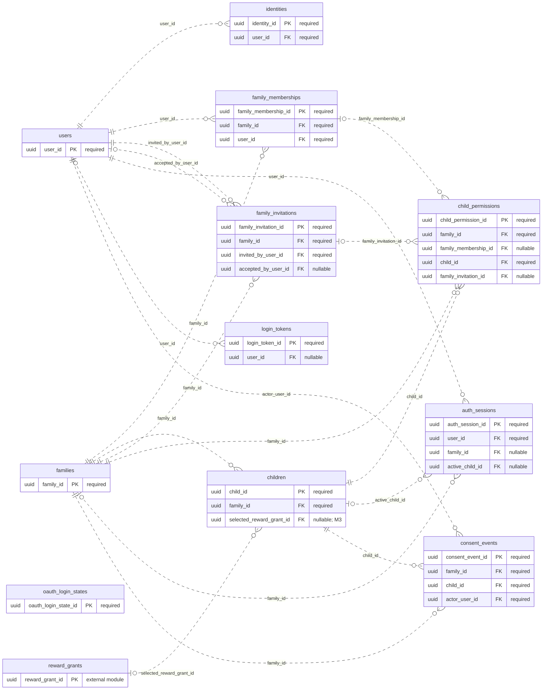

# ERD — Akun dan Akses

Acuan metadata: [schema.json](schema.json). Perbarui model, diagram, dan kamus data bersama ketika rancangan berubah.

[Dokumentasi utama](../../README.md#database) · [Aturan desain](design.md) · [Kamus data lengkap](data-dictionary.md)

Diagram menampilkan PK/FK. Kotak `external module` hanya menunjukkan PK tabel modul lain. Garis mencakup seluruh FK tunggal milik modul ini; FK komposit dan batasan unik bersyarat dirinci di kamus data. Kardinalitas adalah batas struktural FK, bukan jaminan bahwa proses bisnis sudah selesai.

## Tabel dan waktu implementasi

| Tabel | Primary key | Mulai | Tujuan |
| --- | --- | --- | --- |
| [users](data-dictionary.md#users) | `user_id` | S03 | Identitas orang dewasa; anak tidak mempunyai akun login sendiri. |
| [identities](data-dictionary.md#identities) | `identity_id` | S03 | Identitas Google atau email yang telah dibuktikan. |
| [families](data-dictionary.md#families) | `family_id` | S03 | Batas kepemilikan data satu keluarga. |
| [family_memberships](data-dictionary.md#family_memberships) | `family_membership_id` | S03 | Hubungan pengguna dewasa dengan keluarga dan perannya. |
| [children](data-dictionary.md#children) | `child_id` | S03 | Profil belajar anak, berada dalam tepat satu keluarga. |
| [family_invitations](data-dictionary.md#family_invitations) | `family_invitation_id` | M3 | Undangan pengasuh dengan token sekali pakai. |
| [child_permissions](data-dictionary.md#child_permissions) | `child_permission_id` | M3 | Izin per anak: ditawarkan lewat undangan atau efektif lewat membership. |
| [auth_sessions](data-dictionary.md#auth_sessions) | `auth_session_id` | S03 | Sesi login satu browser milik orang dewasa. |
| [login_tokens](data-dictionary.md#login_tokens) | `login_token_id` | S03 | Tautan email login/reset PIN dengan purpose dan masa berlaku. |
| [oauth_login_states](data-dictionary.md#oauth_login_states) | `oauth_login_state_id` | S03 | State/nonce sementara untuk callback OAuth/OIDC. |
| [consent_events](data-dictionary.md#consent_events) | `consent_event_id` | S03 | Jejak pemberian/penarikan persetujuan per fitur dan versi kebijakan. |
