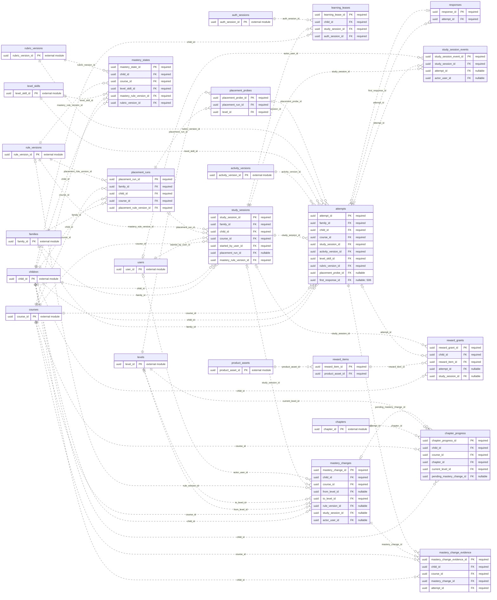

# ERD — Sesi dan Pembelajaran

Acuan metadata: [schema.json](schema.json). Perbarui model, diagram, dan kamus data bersama ketika rancangan berubah.

[Dokumentasi utama](../../README.md#database) · [Aturan desain](design.md) · [Kamus data lengkap](data-dictionary.md)

Diagram menampilkan PK/FK. Kotak `external module` hanya menunjukkan PK tabel modul lain. Garis mencakup seluruh FK tunggal milik modul ini; FK komposit dan batasan unik bersyarat dirinci di kamus data. Kardinalitas adalah batas struktural FK, bukan jaminan bahwa proses bisnis sudah selesai.

## Tabel dan waktu implementasi

| Tabel | Primary key | Mulai | Tujuan |
| --- | --- | --- | --- |
| [placement_runs](data-dictionary.md#placement_runs) | `placement_run_id` | S05 | Satu run tes penempatan yang bisa melintasi beberapa sesi belajar. |
| [placement_probes](data-dictionary.md#placement_probes) | `placement_probe_id` | S05 | Probe suatu tingkat pada run penempatan. |
| [study_sessions](data-dictionary.md#study_sessions) | `study_session_id` | S05 | Sesi anak dengan purpose, posisi, dan rencana yang dapat dilanjutkan. |
| [learning_leases](data-dictionary.md#learning_leases) | `learning_lease_id` | S05 | Riwayat pemberian lease perangkat; paling banyak satu aktif per anak. |
| [responses](data-dictionary.md#responses) | `response_id` | S06 | Respons berurutan; koreksi tidak menimpa respons pertama. |
| [attempts](data-dictionary.md#attempts) | `attempt_id` | S05 | Satu penyajian soal dan hasil logisnya; banyak respons koreksi tetap satu attempt. |
| [study_session_events](data-dictionary.md#study_session_events) | `study_session_event_id` | S06 | Interaksi, hint, bantuan, pause, atau skip yang relevan pada sesi. |
| [mastery_states](data-dictionary.md#mastery_states) | `mastery_state_id` | S07 | Status penguasaan anak pada keterampilan-tingkat dan versi aturan. |
| [mastery_changes](data-dictionary.md#mastery_changes) | `mastery_change_id` | S07 | Keputusan perubahan titik latihan dengan alasan dan bukti. |
| [mastery_change_evidence](data-dictionary.md#mastery_change_evidence) | `mastery_change_evidence_id` | S07 | Bukti relasional untuk satu perubahan tingkat. |
| [chapter_progress](data-dictionary.md#chapter_progress) | `chapter_progress_id` | S07 | Posisi latihan bab dan target perubahan sesi berikutnya. |
| [reward_items](data-dictionary.md#reward_items) | `reward_item_id` | S06 | Katalog stiker/koleksi yang diterbitkan produk. |
| [reward_grants](data-dictionary.md#reward_grants) | `reward_grant_id` | S06 | Pemberian satu item dengan sumber instans atau sesi yang unik. |
