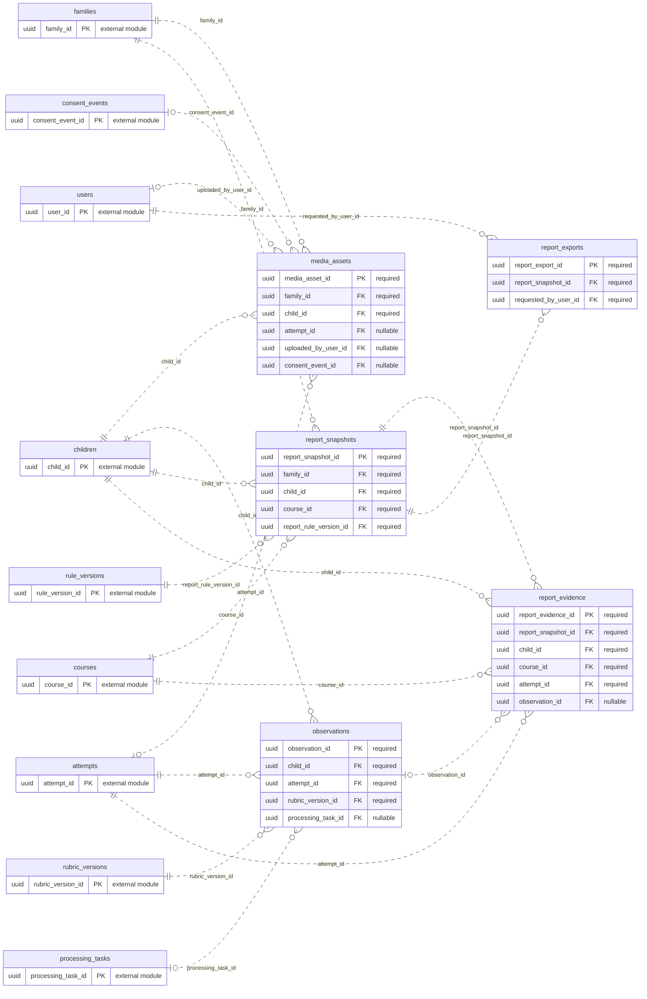

# ERD — Media dan Laporan

Acuan metadata: [schema.json](schema.json). Perbarui model, diagram, dan kamus data bersama ketika rancangan berubah.

[Dokumentasi utama](../../README.md#database) · [Aturan desain](design.md) · [Kamus data lengkap](data-dictionary.md)

Diagram menampilkan PK/FK. Kotak `external module` hanya menunjukkan PK tabel modul lain. Garis mencakup seluruh FK tunggal milik modul ini; FK komposit dan batasan unik bersyarat dirinci di kamus data. Kardinalitas adalah batas struktural FK, bukan jaminan bahwa proses bisnis sudah selesai.

## Tabel dan waktu implementasi

| Tabel | Primary key | Mulai | Tujuan |
| --- | --- | --- | --- |
| [media_assets](data-dictionary.md#media_assets) | `media_asset_id` | S09/M3 | Media pribadi anak, terpisah dari product_assets. |
| [observations](data-dictionary.md#observations) | `observation_id` | M3 | Pengamatan rubrik atas suatu attempt, deterministik/manusia/AI. |
| [report_snapshots](data-dictionary.md#report_snapshots) | `report_snapshot_id` | M3 | Snapshot laporan berbukti untuk ekspor/riwayat; ringkasan M1 boleh query langsung. |
| [report_evidence](data-dictionary.md#report_evidence) | `report_evidence_id` | M3 | Relasi bukti attempt/pengamatan ke key klaim lokal pada snapshot. |
| [report_exports](data-dictionary.md#report_exports) | `report_export_id` | M3 | Permintaan PDF sementara per snapshot dan pengguna. |
