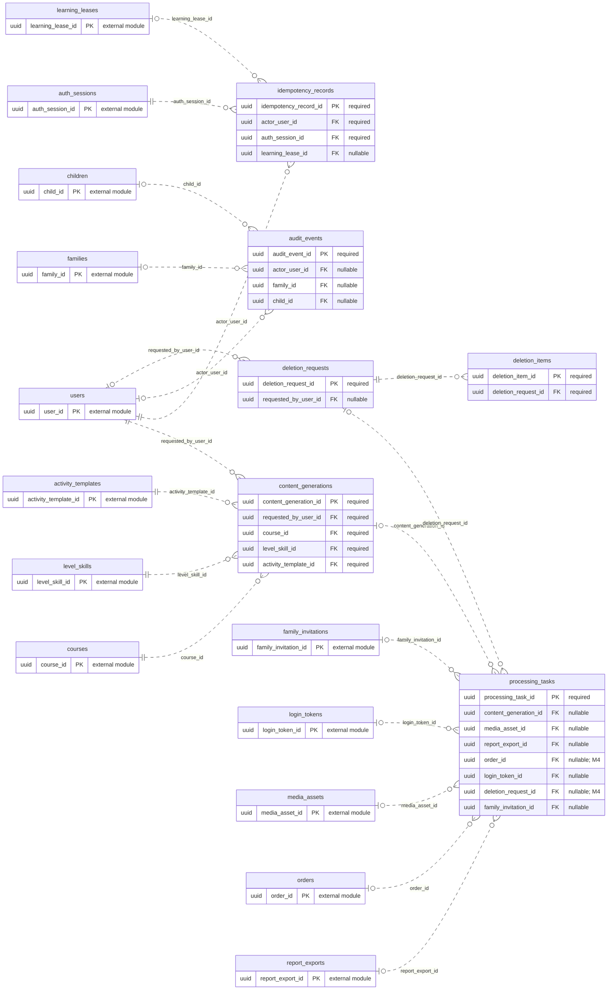

# ERD — AI, Audit, dan Operasional

Acuan metadata: [schema.json](schema.json). Perbarui model, diagram, dan kamus data bersama ketika rancangan berubah.

[Dokumentasi utama](../../README.md#database) · [Aturan desain](design.md) · [Kamus data lengkap](data-dictionary.md)

Diagram menampilkan PK/FK. Kotak `external module` hanya menunjukkan PK tabel modul lain. Garis mencakup seluruh FK tunggal milik modul ini; FK komposit dan batasan unik bersyarat dirinci di kamus data. Kardinalitas adalah batas struktural FK, bukan jaminan bahwa proses bisnis sudah selesai.

## Tabel dan waktu implementasi

| Tabel | Primary key | Mulai | Tujuan |
| --- | --- | --- | --- |
| [content_generations](data-dictionary.md#content_generations) | `content_generation_id` | M3 | Spesifikasi draf soal AI tanpa konteks/data anak. |
| [processing_tasks](data-dictionary.md#processing_tasks) | `processing_task_id` | M3 | Status pekerjaan domain; tidak mengganti tabel queue milik River. |
| [idempotency_records](data-dictionary.md#idempotency_records) | `idempotency_record_id` | S05 | Hasil operasi logis yang dapat dipulihkan tanpa duplikasi efek. |
| [audit_events](data-dictionary.md#audit_events) | `audit_event_id` | S03 | Jejak aksi sensitif dengan payload minimum tersanitasi. |
| [deletion_requests](data-dictionary.md#deletion_requests) | `deletion_request_id` | M4 | Permintaan penghapusan dengan target historis dan progres. |
| [deletion_items](data-dictionary.md#deletion_items) | `deletion_item_id` | M4 | Langkah penghapusan lokal/remote dan bukti retry. |
