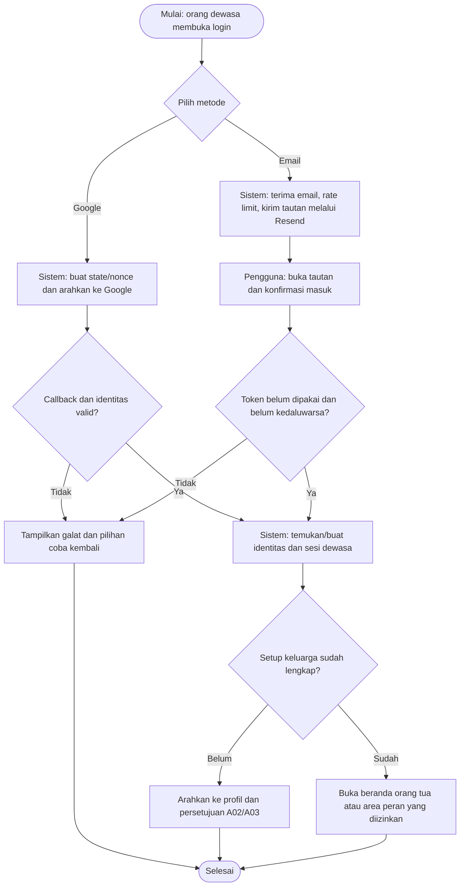
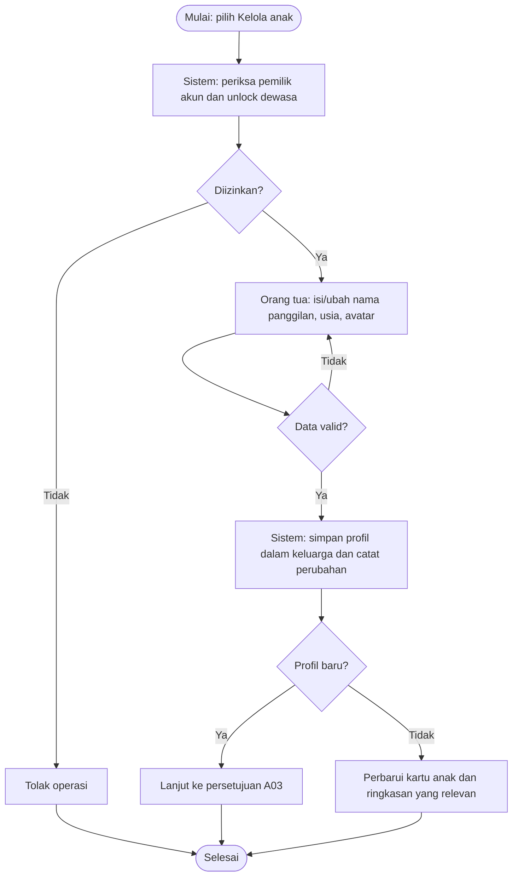
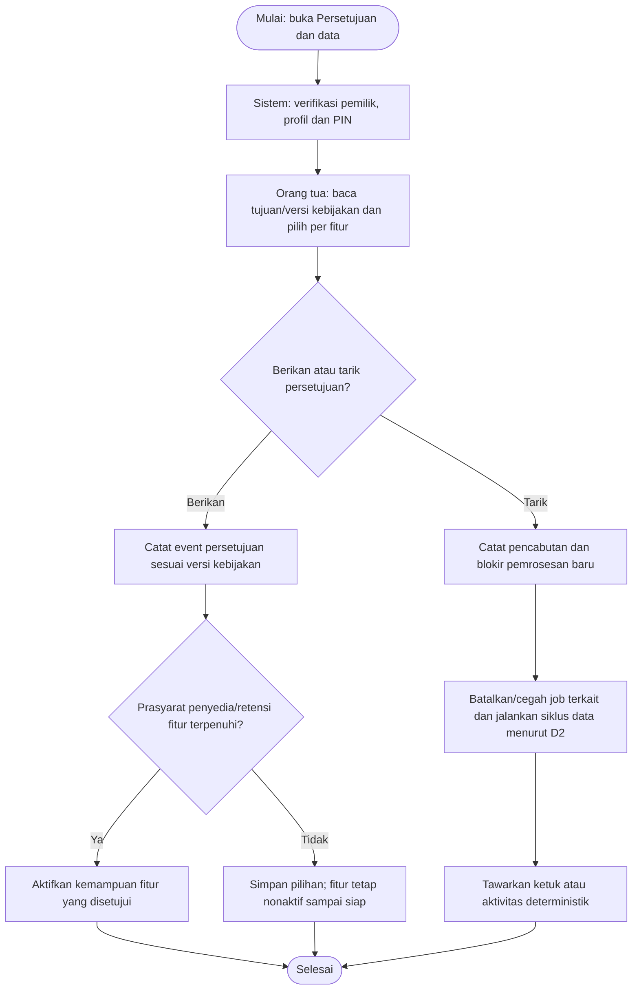
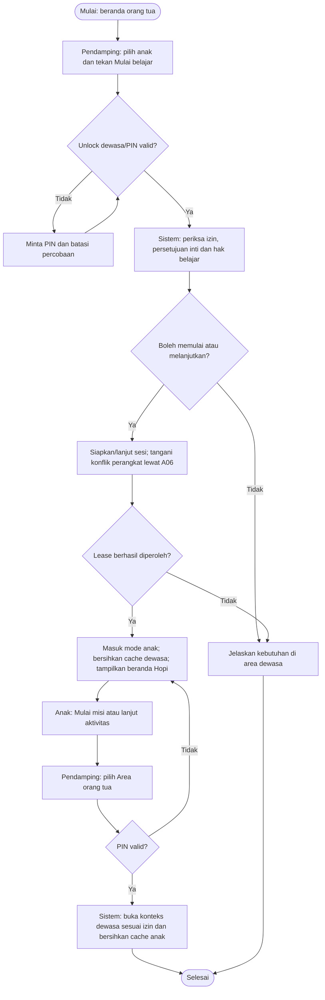
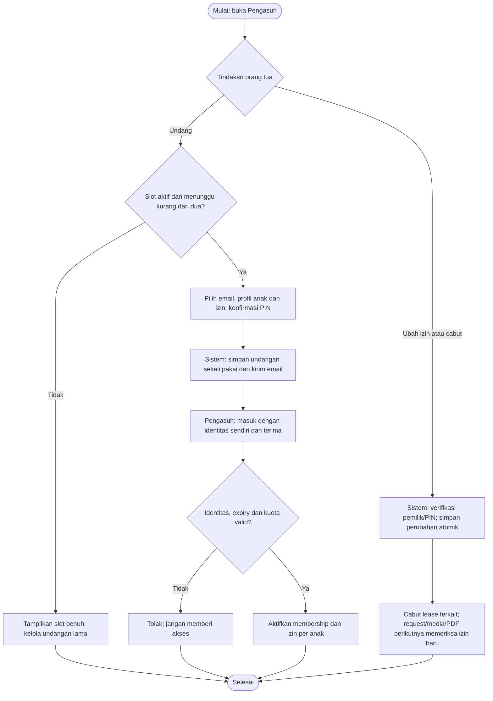
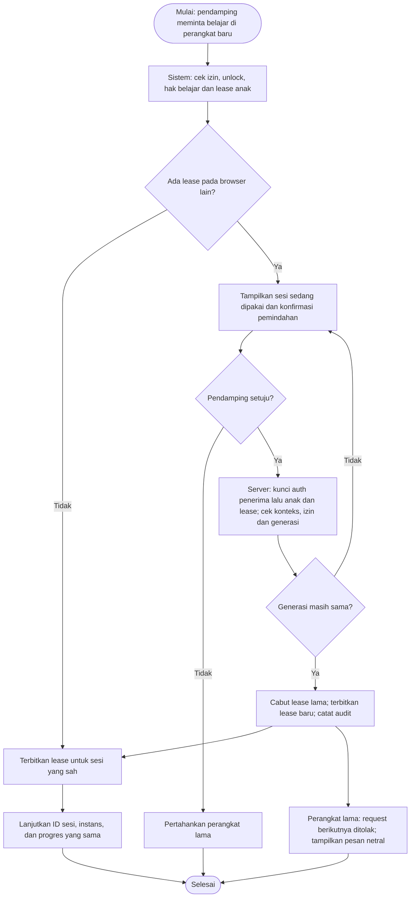
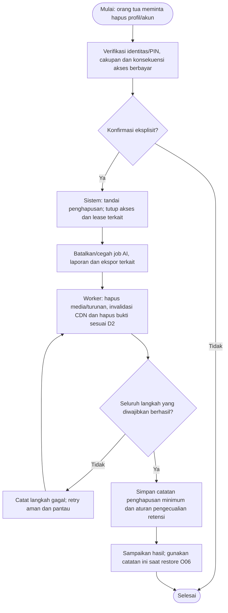

# Hurahopi — Activity Diagram: Akun, Keluarga, dan Akses

Tanggal: 25 Oktober 2026. Status: spesifikasi alur untuk implementasi; belum merupakan fitur yang telah berjalan.

[Indeks diagram dan pemetaan fitur](../../README.md#activity-diagram). Aturan produk/parameter yang masih terbuka mengikuti [keputusan](../decisions.md).

## A01 — Masuk dengan Google atau tautan email

Pelaku: Orang dewasa, sistem, Google/Resend. Cakupan: FR-01; S03.

Login perangkat baru tidak mencabut login dewasa pada perangkat lain. Tautan email dikonsumsi melalui POST setelah konfirmasi, bukan otomatis saat pemindai membuka tautan.

## A02 — Membuat dan mengubah profil anak

Pelaku: Pemilik akun, sistem. Cakupan: FR-02; S03.

Nama panggilan, usia acuan, dan avatar cukup. Profil pengasuh hanya yang diizinkan; pengasuh tidak dapat mengubah profil. Penghapusan memakai A07.

## A03 — Memberikan atau menarik persetujuan

Pelaku: Pemilik akun, sistem. Cakupan: FR-02/09/14; S03/M3.

Persetujuan AI, pemrosesan media, dan portofolio dipisahkan. Pilihan menolak media/AI menyediakan jalur belajar ketuk yang sesuai.

## A04 — Menyiapkan mode anak dan kembali ke orang tua

Pelaku: Pendamping, anak, sistem. Cakupan: FR-03/05; S03/S05.

Pendamping menyiapkan sesi sebelum menyerahkan perangkat. Tombol Mulai pada beranda anak membuka aktivitas sesi yang sudah disiapkan; tidak membuat sesi backend baru tanpa otorisasi dewasa.

## A05 — Undangan, izin, dan pencabutan pengasuh

Pelaku: Pemilik akun, pengasuh, sistem/Resend. Cakupan: FR-10; M3.

Maksimal dua slot termasuk undangan menunggu. Izin awal belajar/laporan; portofolio/PDF terpisah. Ketersediaan selama trial mengikuti finalisasi D3.

## A06 — Memindahkan sesi belajar ke perangkat lain

Pelaku: Pendamping, perangkat lama/baru, sistem. Cakupan: FR-05/06; S05/S06.

Pemindahan hanya setelah konfirmasi dan verifikasi dewasa; ID sesi/instans tetap. Login laporan orang tua tidak dicabut. Jawaban dan transfer diserialisasi di server. Semua tab satu auth_session berbagi konteks: penerima yang masih belajar pada anak lain harus pause eksplisit sebelum transfer; maksimal satu lease aktif per browser. Urutan lock: auth_session penerima → anak → sesi/lease, tanpa mengambil lock auth_session pemilik lama setelah child.

## A07 — Menghapus profil atau akun dan data turunannya

Pelaku: Pemilik akun, sistem, worker/penyedia media. Cakupan: FR-14; M4.

Retensi pengecualian transaksi/cadangan mengikuti D2/D7. Penghapusan karya tunggal ada pada P03. Restore tidak boleh menghidupkan data yang telah dihapus.

