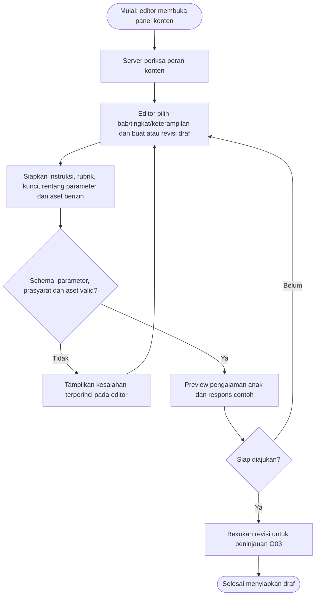
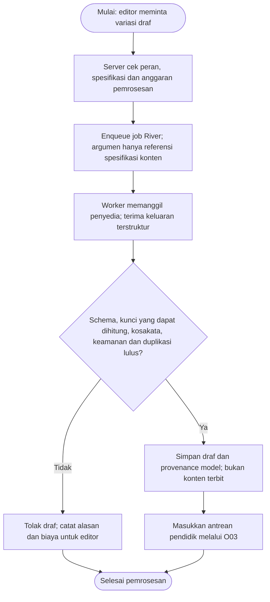
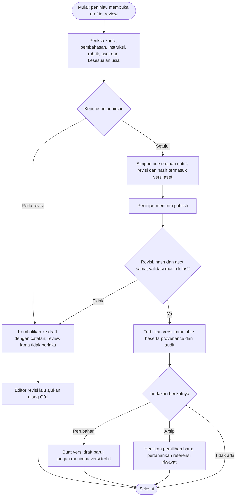
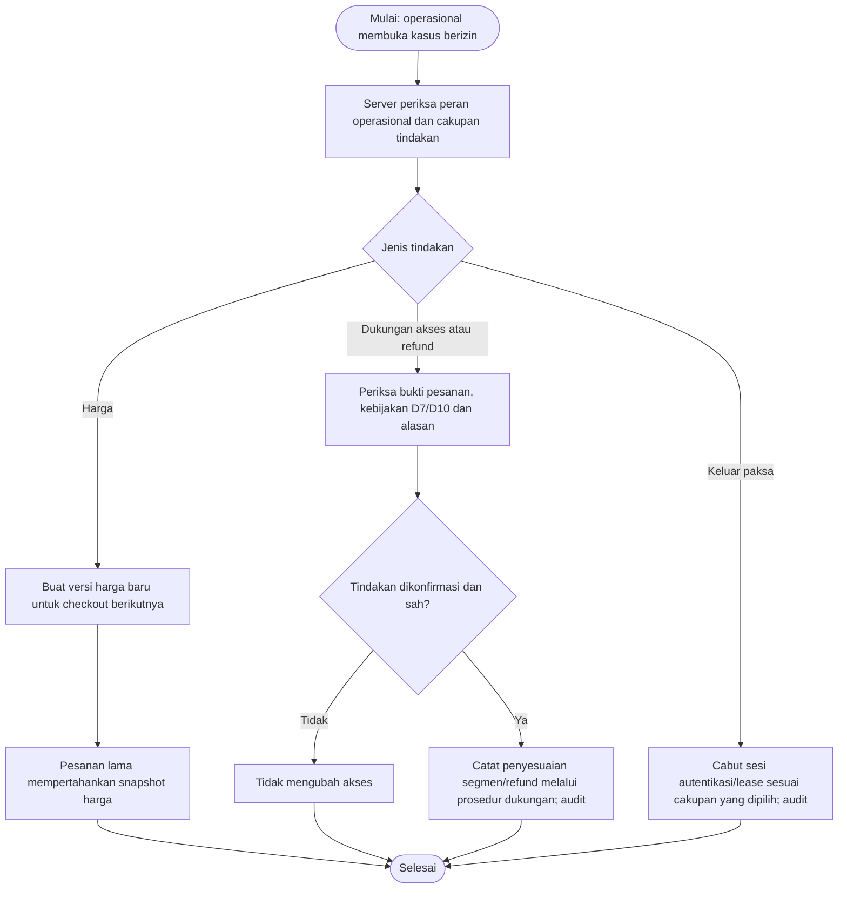
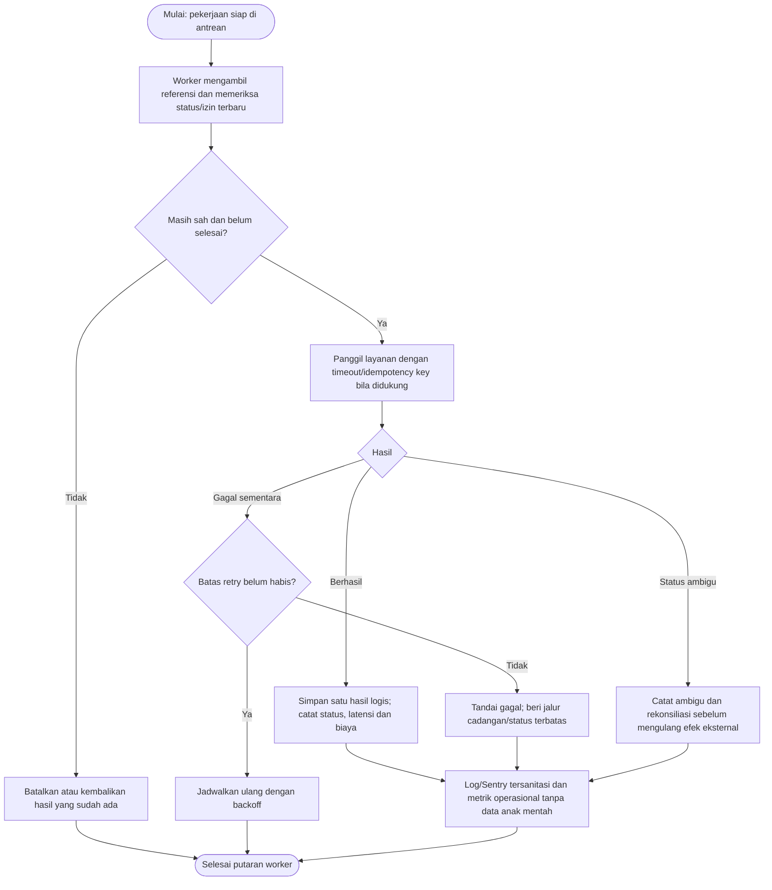
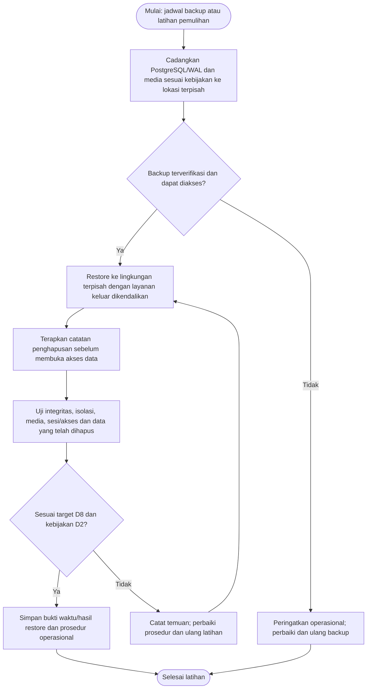

# Hurahopi — Activity Diagram: Konten, Admin, dan Operasional

Tanggal: 25 Oktober 2026. Status: spesifikasi alur untuk implementasi; belum merupakan fitur yang telah berjalan.

[Indeks diagram dan pemetaan fitur](../../README.md#activity-diagram). Aturan produk/parameter yang masih terbuka mengikuti [keputusan](../decisions.md).

## O01 — Menyiapkan konten, aset, dan materi paket

Pelaku: Editor, sistem. Cakupan: FR-08/12; S09/M5.

Mencakup bab, tingkat, keterampilan, parameter generator, narasi/aset, pengantar/video, worksheet dan soal olimpiade. Konten yang belum tersedia tidak boleh dipilih mesin belajar.

## O02 — Pembuatan draf soal AI

Pelaku: Editor, worker/penyedia AI, sistem. Cakupan: FR-08; M3.

Hanya spesifikasi konten dikirim, tanpa data anak. Semua draf termasuk numerik wajib ditinjau pendidik; tidak ada generasi langsung saat anak bermain.

## O03 — Peninjauan, publikasi versi, dan pengarsipan

Pelaku: Pendidik/peninjau, editor, sistem. Cakupan: FR-08; layanan/peran/review minimum S04, UI lengkap S09.

Review terikat revisi dan hash seluruh isi efektif, termasuk binding/checksum aset. Perubahan draf membatalkan persetujuan; versi/binding/aset terbit tidak ditimpa. Layanan S04 mencatat review sebelum uji keluarga S08 meskipun UI S09 belum tersedia. Arsip mencegah pemilihan baru tetapi versi yang sudah dirujuk percobaan tetap dapat ditelusuri.

## O04 — Harga, dukungan, penyesuaian akses, dan keluar paksa

Pelaku: Pengelola operasional, sistem. Cakupan: FR-12/13/14; M4.

Aksi memerlukan peran eksplisit dan alasan audit. Harga/refund mengikuti D7/D10; perubahan akses manual tidak boleh memalsukan status pembayaran gateway.

## O05 — Worker, kegagalan layanan, biaya, dan pemantauan

Pelaku: Worker River, sistem, operasional. Cakupan: FR-08/09/11/13/14; M3/M4.

Queue membawa ID referensi. Izin/penghapusan diperiksa lagi sebelum memproses dan menyajikan hasil; retry tidak menggandakan hasil logis atau biaya lewat panggilan berulang tanpa kontrol.

## O06 — Cadangan, pemulihan, dan pencegahan data terhapus muncul kembali

Pelaku: Operasional, sistem database/media. Cakupan: FR-14; M4.

Target RPO/RTO dan jadwal retensi mengikuti D2/D8. Bukti uji restore disimpan; backup yang ada saja belum membuktikan pemulihan berhasil.

