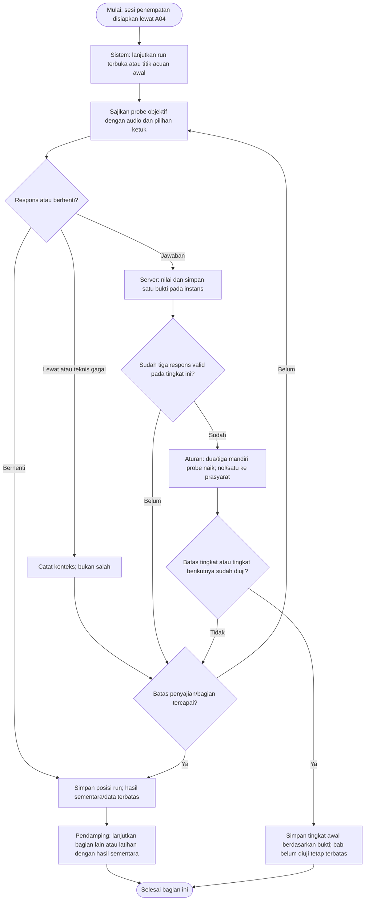
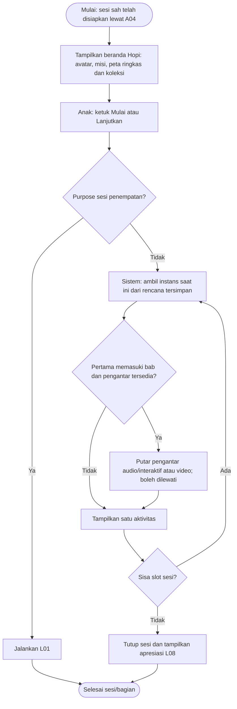
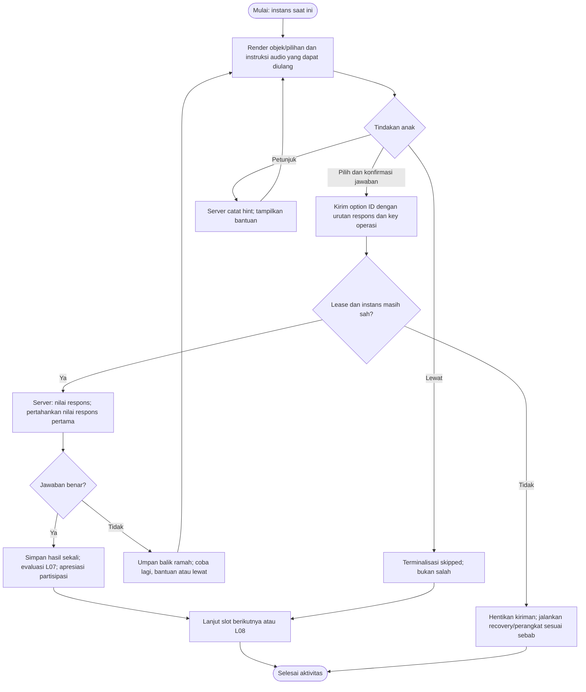
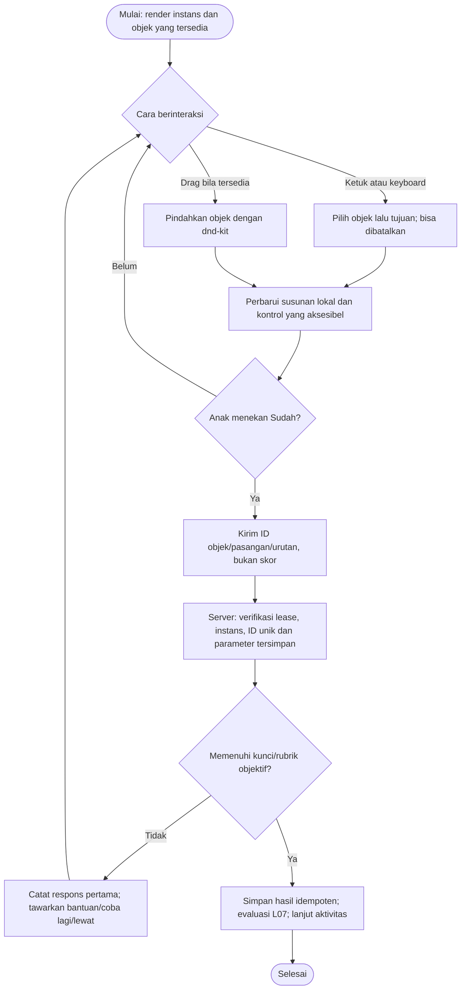
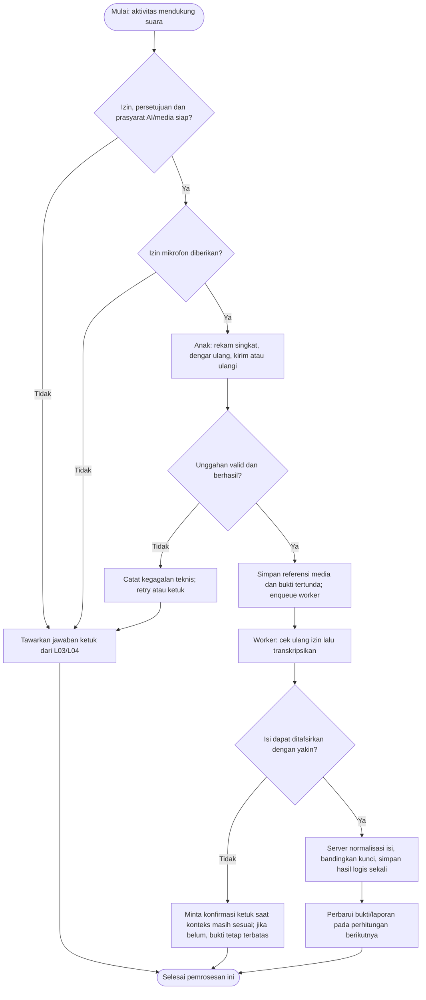
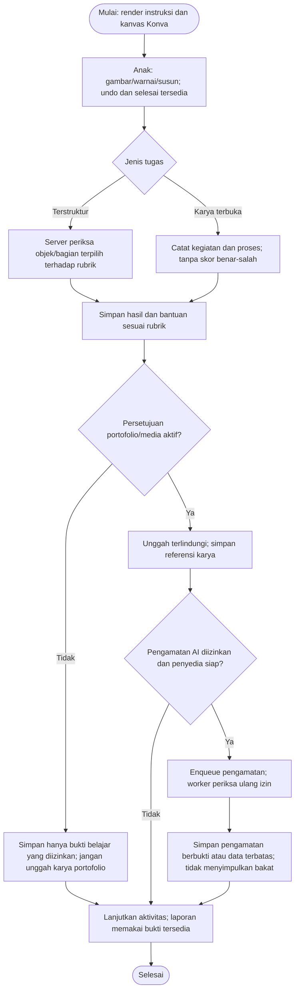
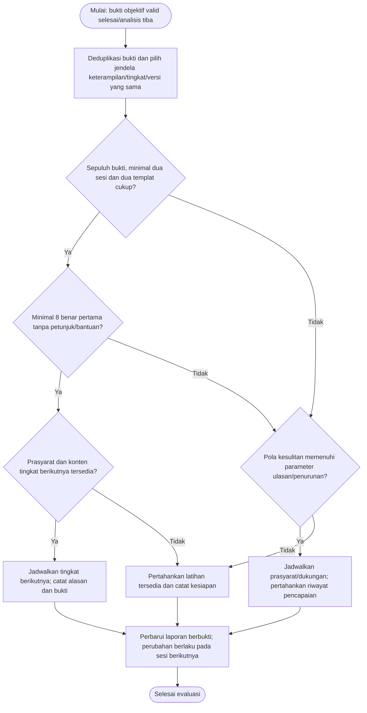
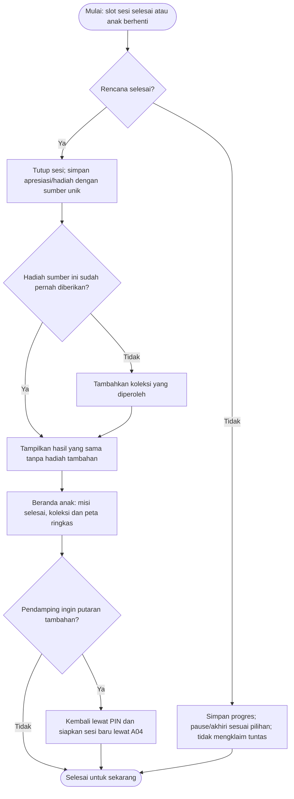
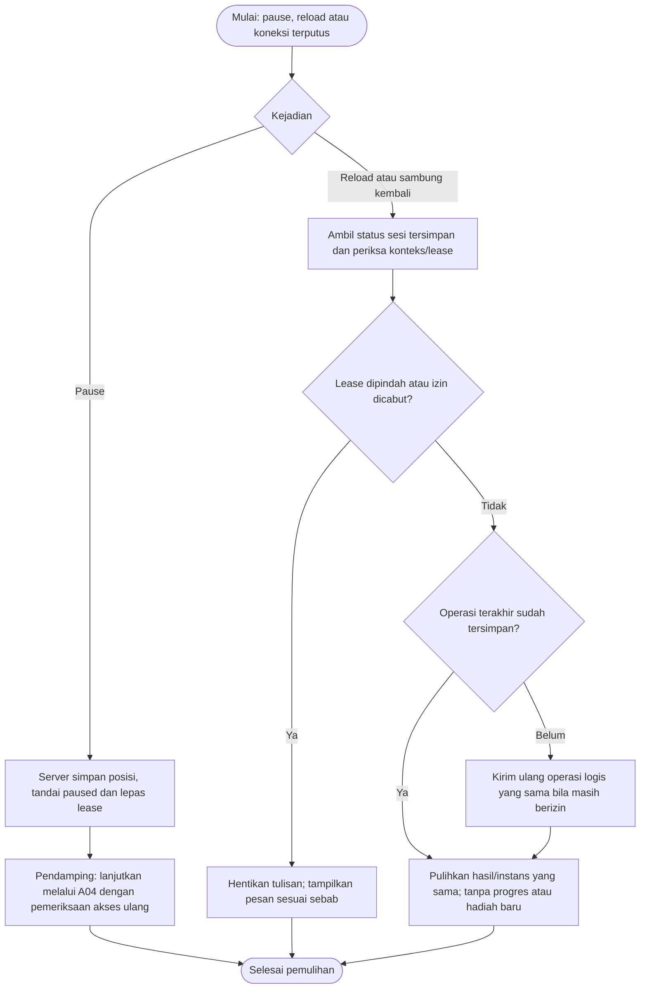

# Hurahopi — Activity Diagram: Pengalaman Anak dan Pembelajaran

Tanggal: 25 Oktober 2026. Status: spesifikasi alur untuk implementasi; belum merupakan fitur yang telah berjalan.

[Indeks diagram dan pemetaan fitur](../../README.md#activity-diagram). Aturan produk/parameter yang masih terbuka mengikuti [keputusan](../decisions.md).

## L01 — Tes penempatan dan hasil sementara

Pelaku: Anak, pendamping, sistem. Cakupan: FR-04; S05.

Menggunakan parameter uji placement-v0.1. Usia hanya titik awal. Tiga respons valid diperlukan untuk menyimpulkan satu probe; skip/teknis tidak dianggap salah.

## L02 — Beranda anak, misi, dan pengantar bab

Pelaku: Pendamping, anak, sistem. Cakupan: FR-04/05/06; S04/S05.

Beranda Hopi ditampilkan setelah sesi disiapkan. Misi latihan menggunakan rencana sesi yang dibekukan. Penempatan memakai versi aturan/batas yang dibekukan dan memilih probe berikutnya berdasarkan hasil, dengan instans yang sudah disajikan tetap tersimpan. Pengantar interaktif/video opsional mengikuti D12. Tidak ada penawaran paket di layar anak.

## L03 — Pilihan visual dan soal cerita objektif

Pelaku: Anak, sistem. Cakupan: FR-06; S04/S06.

Juga pola dasar untuk memilih jumlah/bentuk, soal cerita audio, dan pilihan pada garis bilangan. Jangan mengirim kunci ke browser; memutar ulang instruksi bukan hint.

## L04 — Membuat kelompok, mencocokkan, dan menyusun

Pelaku: Anak, sistem. Cakupan: FR-06; S04/S06.

Pola input terstruktur untuk build_group, pasangan, urutan, bingkai sepuluh, potongan bentuk, memori pasangan, atau posisi garis bilangan. Kebenaran ditentukan dari representasi logis server, bukan koordinat/screenshot klien.

## L05 — Jawaban suara dan alternatif ketuk

Pelaku: Anak, sistem, worker/penyedia AI. Cakupan: FR-06/09; M3.

Fitur data anak memerlukan D2/D5, persetujuan, dan kesiapan penyedia. Penilaian isi jawaban tetap server; pelafalan tidak dinilai. Analisis tertunda tidak mengganti instans yang sedang tampil.

## L06 — Menggambar, mewarnai, dan karya terbuka

Pelaku: Anak, sistem, worker opsional. Cakupan: FR-06/09; M3.

Kanvas terstruktur dapat diperiksa deterministik. Portofolio dan pengamatan AI mempunyai izin/prasyarat terpisah; karya terbuka tidak mendapat nilai benar-salah.

## L07 — Evaluasi penguasaan dan titik latihan berikutnya

Pelaku: Sistem, pendidik melalui parameter. Cakupan: FR-07; S07.

mastery-v0.1 adalah parameter uji. Ambang ringkasan laporan tiga aktivitas/dua sesi berbeda dari syarat naik tingkat 8/10. Pencapaian lama tidak dihapus saat perlu ulasan.

## L08 — Apresiasi, koleksi, dan akhir sesi

Pelaku: Anak, sistem, pendamping. Cakupan: FR-06/07; S06/S07.

Koleksi diberikan sekali per sumber. Personalisasi memakai item yang dimiliki dengan pemeriksaan konteks anak pada milestone fiturnya. Tidak ada loop sesi tambahan otomatis atau pesan membeli kepada anak.

## L09 — Pause, muat ulang, dan koneksi terputus

Pelaku: Anak/pendamping, browser, sistem. Cakupan: FR-05/06; S05/S06.

Retry memakai instans, urutan respons, dan idempotency key yang sama. Lease transfer/logout/izin dicabut menolak replay; penutupan normal boleh memulihkan hasil tersimpan sesuai spesifikasi teknis.

