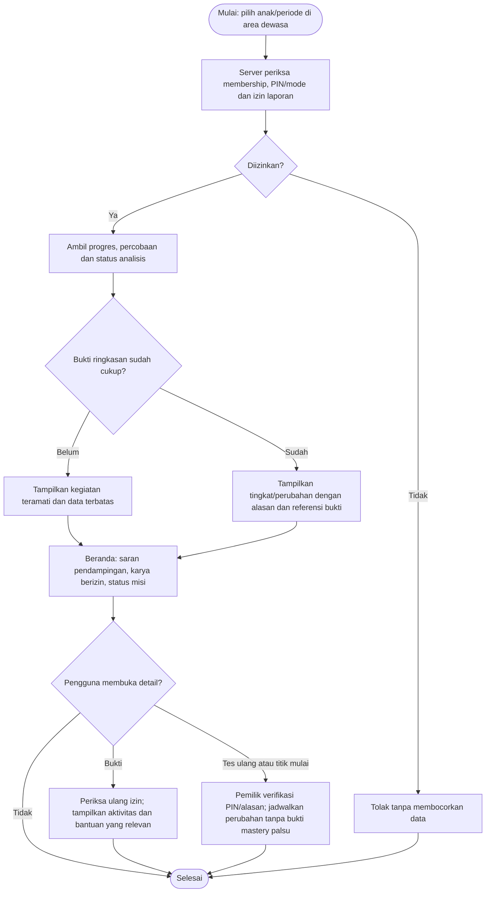
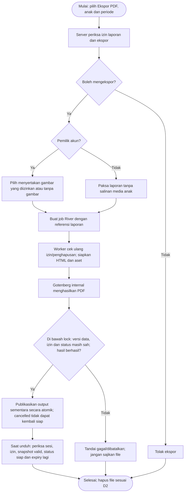
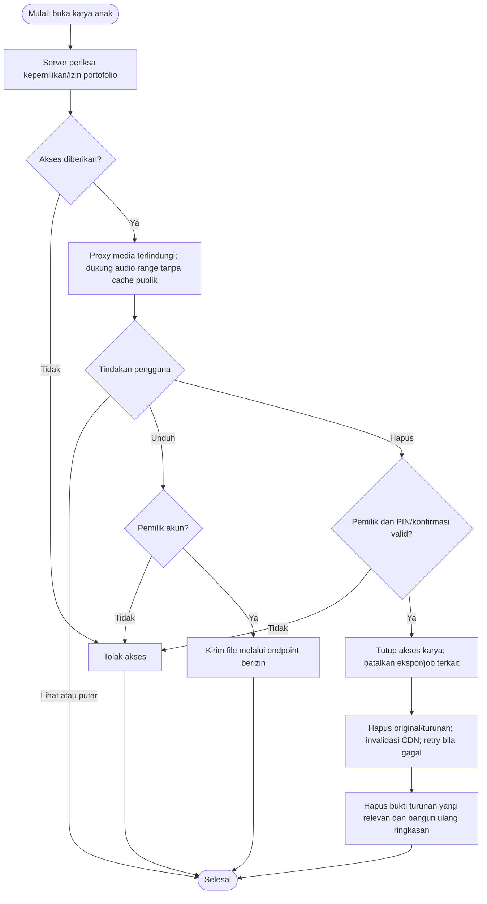
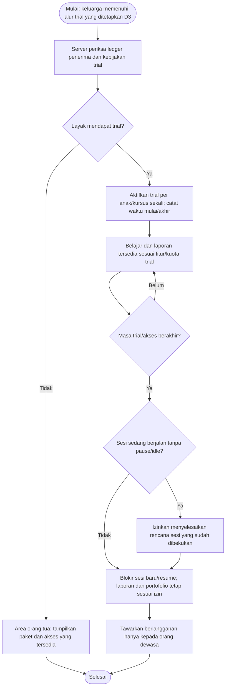
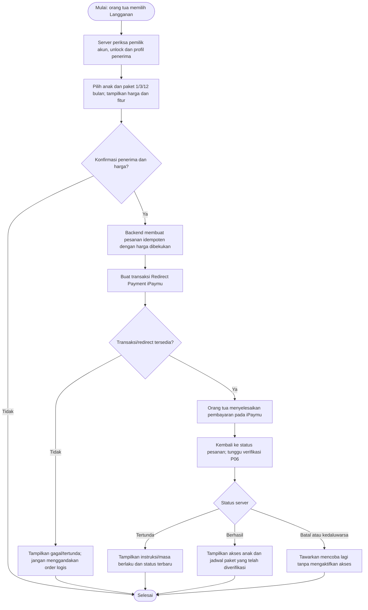
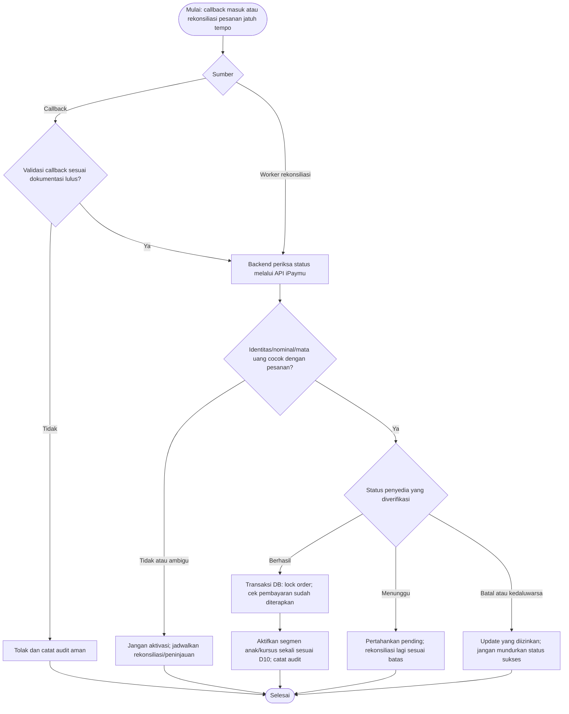
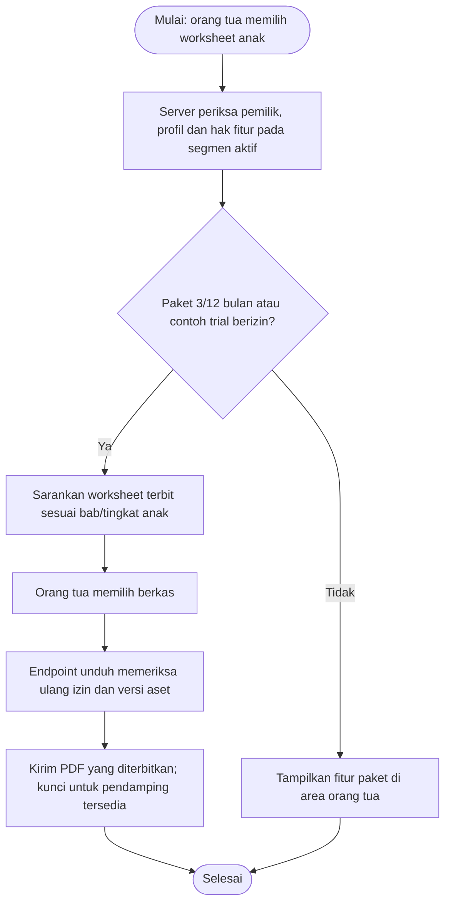
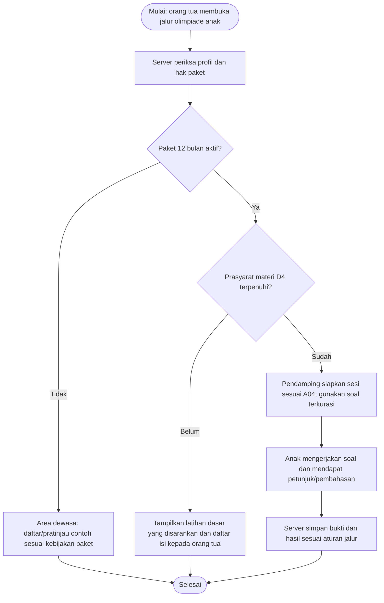

# Hurahopi — Activity Diagram: Orang Tua, Laporan, dan Pembayaran

Tanggal: 25 Oktober 2026. Status: spesifikasi alur untuk implementasi; belum merupakan fitur yang telah berjalan.

[Indeks diagram dan pemetaan fitur](../../README.md#activity-diagram). Aturan produk/parameter yang masih terbuka mengikuti [keputusan](../decisions.md).

## P01 — Beranda orang tua, laporan, dan bukti

Pelaku: Orang tua atau pengasuh berizin, sistem. Cakupan: FR-07/10/12; S07.

Ringkasan berfokus pada anak yang dipilih. Laporan tetap dapat dibaca setelah akses belajar berakhir. Pengasuh tidak mendapat media privat tanpa izin portofolio.

## P02 — Ekspor laporan PDF

Pelaku: Orang tua/pengasuh berizin, sistem, worker/Gotenberg. Cakupan: FR-11; M3.

Orang tua boleh memilih gambar; PDF pengasuh tanpa salinan media anak. Worker merender tanpa menahan transaksi. Publikasi hasil mengunci child lalu snapshot/ekspor dan memeriksa data_version, status, serta izin; penghapusan memakai lock child yang sama. File sementara dan izin unduh diperiksa ulang, termasuk setelah pencabutan atau penghapusan.

## P03 — Melihat, mengunduh, atau menghapus portofolio

Pelaku: Orang tua/pengasuh berizin, sistem/Cloudinary. Cakupan: FR-09/10/14; M3/M4.

Pengasuh hanya melihat/memutar bila diizinkan; tidak mengunduh/menghapus media. Media, turunan, dan PDF yang terdampak mengikuti penghapusan D2.

## P04 — Uji coba tujuh hari dan masa akses habis

Pelaku: Orang tua, sistem. Cakupan: FR-12; M4.

Tujuh hari tanpa kartu ditetapkan; penerima, titik mulai, kuota, dan perpanjangan masih mengikuti D3. Diagram tidak menetapkan angka kebijakan yang belum disetujui.

## P05 — Membeli dan memperpanjang paket

Pelaku: Pemilik akun, sistem, iPaymu. Cakupan: FR-12/13; M4.

Pesanan tepat satu anak/kursus dan versi harga. Jadwal segmen/perubahan paket mengikuti D10; harga/refund D7. Halaman kembali tidak mengaktifkan akses.

## P06 — Callback pembayaran dan rekonsiliasi

Pelaku: iPaymu, API, worker, sistem akses. Cakupan: FR-13; M4.

Nominal/mata uang/referensi/penerima dicocokkan dengan pesanan. Respons berulang atau datang terlambat tidak menambah segmen akses dua kali atau memundurkan status berhasil.

## P07 — Worksheet printable

Pelaku: Pemilik akun, sistem. Cakupan: FR-12; M4.

Akses penuh paket 3/12 bulan; contoh trial mengikuti D3. File yang telah diunduh tetap dimiliki orang tua, tetapi unduhan baru memerlukan hak yang sesuai.

## P08 — Latihan olimpiade

Pelaku: Orang tua/anak, sistem. Cakupan: FR-06/12; M4/M5.

Paket 12 bulan membuka fitur; cakupan dan prasyarat pedagogis mengikuti D4. Pratinjau contoh tidak membuka keseluruhan bank soal atau menjadi jalur mastery utama tanpa aturan D4.

