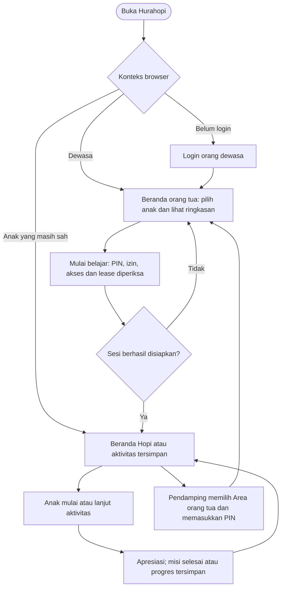

# Hurahopi — Alur Layar dan Prototipe

[Dokumentasi utama](../README.md).

Tanggal: 26 Oktober 2026. Status: spesifikasi layar untuk dibangun dan diuji; belum merupakan hasil uji pengguna.

Token visual, arah Hopi, tipografi, komponen/state, serta tata letak lintas lebar dirinci pada [desain antarmuka](desain.md). Dokumen UX ini tetap menjadi acuan perilaku dan alur, dengan sketsa sebagai contoh struktur.

Acuan produk: [PRD](prd.md). Konten contoh: [spesifikasi pembelajaran](learning-spec.md#contoh-bab-awal). Kontrak dan perilaku server: [spesifikasi teknis](technical-spec.md). Referensi merek lokal opsional berada di `references/hurahopi-site/index.html` dan `references/hurahopi_copywriting_revised.html`, relatif terhadap root proyek. Folder tersebut tidak masuk Git; arah visual untuk implementasi tersedia pada desain antarmuka. Klaim/fitur pada referensi lama mengikuti PRD terbaru ketika ada perbedaan.

## Tiga Pengalaman dalam Satu Aplikasi

Pengalaman utama belajar adalah **dunia Hopi untuk anak**. Area orang tua membantu menyiapkan belajar dan memahami perkembangannya; area admin mengelola konten serta operasi.

| Area | Pertanyaan pengguna | Bentuk layar |
| --- | --- | --- |
| Anak | “Hari ini aku bermain dan belajar apa bersama Hopi?” | Beranda petualangan, satu misi utama, aktivitas bergambar, peta ringkas, koleksi |
| Orang tua/pengasuh | “Apa yang dipelajari anak, bagaimana perkembangannya, dan bagaimana mendampinginya?” | Ringkasan per anak, bukti aktivitas, karya, saran rumah, dan tombol menyiapkan belajar |
| Admin | “Konten dan layanan apa yang perlu ditinjau atau dikelola?” | Tabel, filter, form, antrean review, pesanan, dan operasi sesuai peran |

Satnaing menjadi sumber layout/navigasi/tabel terpilih untuk area orang tua. Desain yang dihasilkan mengikuti kebutuhan keluarga dan merek Hurahopi, dengan jumlah menu serta informasi yang disederhanakan. Shadcn Admin Kit dipakai pada area admin. Dunia anak dirancang khusus menggunakan komponen aktivitas dan aset Hopi; shadcn/Base UI tetap dapat menyediakan primitive umum seperti dialog pendamping.

## Tata Letak Orang Tua

Beranda berfokus pada **satu anak yang sedang dipilih**. Pemilih profil selalu jelas; perubahan profil mengganti seluruh ringkasan dan cache terkait. Nama penerima tetap terlihat pada laporan, karya, dan pembelian sehingga data kakak/adik tidak tertukar.

[Lihat sketsa beranda orang tua, desktop dan ponsel](wireframes/parent-home.svg).

```text
DESKTOP
┌─────────────────────────────────────────────────────────────┐
│ Hurahopi       Anak: [Alya ▾]                  Akun orang tua │
├──────────────┬──────────────────────────────────────────────┤
│ Beranda      │ Halo! Ini perjalanan belajar Alya.           │
│ Perkembangan │ [Misi hari ini]             [Mulai belajar]   │
│ Karya        │                                              │
│ Keluarga     │ [Hari belajar] [Aktivitas] [Fokus latihan]    │
│ Langganan    │                                              │
│              │ Perkembangan singkat    Saran di rumah       │
│              │ + lihat bukti           + kegiatan konkret  │
│ Pengaturan   │ Karya terbaru / kegiatan terbaru             │
└──────────────┴──────────────────────────────────────────────┘
```

Susunan prioritas:

1. Pemilih anak, status misi, dan **Mulai belajar/Lanjutkan**. Ini tindakan utama untuk menyiapkan perangkat anak.
2. Ringkasan sederhana: hari belajar pada periode yang dipilih, aktivitas yang tersimpan, serta keterampilan yang sedang dilatih. Angka adalah informasi kegiatan; jangan mengubahnya menjadi label kemampuan tanpa bukti.
3. Perkembangan singkat dengan alasan dan tombol “Lihat bukti”. Bila data belum cukup, tampilkan kegiatan yang sudah dicoba dan “Bukti masih terbatas”.
4. Satu saran pendampingan konkret, misalnya menghitung sendok saat menyiapkan makan.
5. Karya/kegiatan terbaru yang diizinkan. Status paket tersedia melalui Langganan; kebutuhan memperbarui akses disampaikan kepada orang dewasa.

Pada ponsel, konten menjadi satu kolom. Navigasi bawah cukup **Beranda, Perkembangan, Karya, Menu**; Keluarga, Langganan, dan Pengaturan berada pada Menu. Pilihan anak dan tombol Mulai tetap mudah ditemukan. Di perangkat orang tua yang berbeda, membaca laporan tidak memindahkan belajar anak.

| Menu | Isi | Batas akses |
| --- | --- | --- |
| Beranda | Ringkasan anak terpilih, menyiapkan belajar, saran, kegiatan terbaru | Pemilik atau pengasuh pada profil yang diizinkan |
| Perkembangan | Peta Belajar, periode, alasan perubahan, bukti, ekspor PDF | Pengasuh perlu izin PDF untuk ekspor |
| Karya | Gambar dan rekaman; lihat/putar, unduh/hapus bagi pemilik | Pengasuh perlu izin portofolio; tidak mengunduh/menghapus |
| Keluarga | Profil, pengasuh, izin, persetujuan dan data | Pengelolaan oleh pemilik; pengasuh tidak mendapat menu pengelolaan |
| Langganan | Paket per anak, masa akses, worksheet dan olimpiade sesuai hak | Pembelian oleh pemilik; fitur paket tetap diperiksa server |

Nilai pada sketsa adalah data sintetis. Sketsa menunjukkan hierarki dan penempatan konten; bukan desain visual yang telah diuji atau kontrak angka KPI.

## Tata Letak Utama Anak

[Lihat sketsa beranda anak dan layar aktivitas](wireframes/child-experience.svg).

```text
BERANDA ANAK
┌───────────────────────────────────────────────────────────┐
│ Avatar Alya       Hurahopi       Audio    Area orang tua   │
│                                                           │
│               Dunia Hopi / suasana petualangan             │
│              “Ayo bantu Hopi menyiapkan bekal!”            │
│                                                           │
│                    [ MULAI MISI ]                         │
│                                                           │
│             [Petualanganku]    [Koleksiku]                 │
└───────────────────────────────────────────────────────────┘

SAAT AKTIVITAS
┌───────────────────────────────────────────────────────────┐
│ [Berhenti]         Penanda langkah sederhana               │
│                                                           │
│ Hopi: “Pilih piring berisi tiga apel.”   [Dengar lagi]      │
│                                                           │
│             [2 apel]    [3 apel]    [4 apel]               │
│                                                           │
│             [Bantu aku]        [Ini jawabanku]             │
└───────────────────────────────────────────────────────────┘
```

Beranda mempunyai satu tindakan utama, **Mulai misi** atau **Lanjutkan**. Hopi, ilustrasi, audio, dan benda konkret menjadi pemandu. Petualanganku menampilkan perjalanan yang sudah dilalui; Koleksiku menampilkan apresiasi yang dimiliki. Keduanya menjadi tindakan pendukung, bukan pilihan bebas untuk melewati prasyarat atau menentukan soal sendiri.

Pada aktivitas, navigasi beranda/peta/koleksi disembunyikan agar satu tugas menjadi pusat perhatian. Pilihan ketuk menandai jawaban, lalu anak mengonfirmasi dengan tombol besar; tugas menyusun memakai “Sudah”. “Dengar lagi” hanya mengulang instruksi, sedangkan “Bantu aku” merupakan petunjuk yang tercatat. Anak boleh berhenti atau melewati aktivitas tanpa hukuman.

| Keadaan beranda anak | Tindakan utama | Perilaku |
| --- | --- | --- |
| Sesi penempatan sudah disiapkan | “Mulai petualangan” | Masuk tes singkat; tidak menampilkan skor/peringkat |
| Misi siap | “Mulai misi” | Membuka aktivitas dari sesi yang sudah disiapkan pendamping |
| Sesi aktif dan instans belum selesai | “Lanjutkan” | Memulihkan instans dan susunan yang sama |
| Sesi paused/idle dan perlu resume | “Ajak pendamping” | Pendamping membuka PIN dan menyiapkan resume dengan pemeriksaan akses |
| Misi selesai | “Selesai untuk hari ini” serta lihat koleksi | Tidak membuat sesi baru otomatis; putaran tambahan disiapkan orang dewasa |
| Akses perlu diperbarui | Pesan/audio netral “Ajak pendampingmu, ya” | Penjelasan paket/pembayaran hanya di area dewasa |
| Belajar dipindahkan ke perangkat lain | Pesan netral bahwa belajar dilanjutkan di perangkat lain | Perangkat ini tidak mengirim jawaban baru; akses dewasa lewat PIN |

Petualanganku menampilkan lokasi/bab sebagai perjalanan bergambar dan penanda posisi saat ini. Anak boleh melihat pencapaian; mesin tetap memilih aktivitas sesuai bukti dan konten terbit. Koleksiku berisi stiker/item yang sudah dimiliki; hadiah tidak berkurang karena absen. Personalisasi item yang dimiliki mengikuti konteks anak dan kontrak fitur saat implementasi, tanpa pembelian atau undangan pengguna dari area anak.

Untuk usia 4–5, objek dan pilihan lebih sedikit/besar, dengan audio yang mudah diulang. Usia 8–10 dapat melihat materi dan simbol yang lebih kompleks sesuai penempatan, dengan struktur layar tetap konsisten. Ponsel memakai pilihan yang membungkus secara vertikal; tablet/laptop boleh menata pilihan sejajar. Tidak mewajibkan drag atau memaksa orientasi perangkat sebagai syarat tugas yang dapat dikerjakan dengan ketuk. Alternatif ketuk untuk drag sejalan dengan [WCAG 2.2 tentang dragging movements](https://www.w3.org/WAI/WCAG22/Understanding/dragging-movements.html).

## Masuk Aplikasi dan Penyerahan Perangkat

- Pengunjung tanpa sesi masuk melalui login orang dewasa. Setelah login, beranda orang tua menampilkan anak yang boleh dikelola/didampingi.
- Pendamping memilih anak lalu “Mulai belajar”, memverifikasi PIN, dan menyiapkan penempatan atau misi. Backend memeriksa izin, persetujuan, hak belajar, dan lease; konflik perangkat meminta konfirmasi.
- Sesudah sesi berhasil disiapkan, browser masuk mode anak dan menampilkan beranda Hopi. Anak mengetuk Mulai untuk membuka aktivitas yang telah disiapkan; tombol tersebut tidak membuat sesi backend baru tanpa otorisasi dewasa.
- Browser yang dibuka kembali dalam konteks anak yang masih sah kembali ke beranda/aktivitas anak tersebut. Selesai/pause/pencabutan ditangani sesuai status server; halaman dewasa tidak dibuka otomatis.
- Kembali ke orang tua melalui tombol pendamping dan PIN. Ganti profil dilakukan di area dewasa. Laporan orang tua pada perangkat lain dapat tetap dibuka.

Alur ini mempertahankan aturan sesi yang sudah disepakati. Kebutuhan penyederhanaan handoff setelah uji keluarga dibahas sebagai perubahan UX/otorisasi yang eksplisit, bukan menghilangkan pemeriksaan server secara diam-diam.

## Prinsip dan komponen

Fondasi implementasi D1/D6: shadcn/ui varian Base UI dan Tailwind, layout orang tua terpilih dari Satnaing, serta Shadcn Admin Kit untuk area admin. Seluruh area memakai TanStack Router; komponen sumber diselaraskan dengan token Hurahopi. Nama paket dan tahap pemasangan mengikuti [arsitektur](architecture.md#stack-inti-dan-layanan-pendukung).

Anak melihat satu tujuan per layar, objek konkret, instruksi audio Indonesia yang dapat diulang, dan apresiasi tanpa hukuman. Orang dewasa melihat informasi ringkas yang dapat ditelusuri ke aktivitas. Pembayaran, pengelolaan data, dan pengaturan akun berada di area dewasa.

| Komponen | Perilaku awal |
| --- | --- |
| `InstructionPlayer` | Tombol ulang audio selalu terlihat; autoplay tidak menjadi syarat; teks instruksi tersedia untuk pendamping |
| `ChoiceGroup` | Pilihan dapat diketuk atau dioperasikan dengan keyboard; urutan tetap setelah reload; nama aksesibel menjelaskan opsi tanpa membocorkan kunci |
| `ObjectTray` | Ketuk objek untuk memindahkan ke keranjang dan ketuk lagi untuk mengembalikan; drag dari dnd-kit ketika ditambahkan; tidak bergantung pada presisi motorik |
| `HintButton` | Permintaan dicatat server sebelum hint muncul; mengulang audio instruksi tidak memanggil endpoint hint |
| `ActivityFeedback` | Benar: "Pas! Ada tiga apel." Salah: "Ayo kita hitung bersama." Tanpa suara alarm, peringkat, atau hitung mundur |
| `SessionProgress` | Penanda langkah sederhana tanpa tekanan waktu; tombol berhenti tersedia |
| `AdultGate` | PIN diperiksa server; membuka dialog PIN tidak memuat data dewasa di belakangnya |
| `EvidenceCard` | Menampilkan aktivitas, bantuan, tanggal, dan keterkaitan dengan klaim laporan; bukan label bakat permanen |

Target sentuh prototipe minimal 48 × 48 CSS pixel untuk dewasa dan 56 × 56 untuk anak, dengan jarak yang memadai; ini default pada desain antarmuka yang diuji pada perangkat sasaran. Fokus keyboard terlihat, warna bukan satu-satunya penanda, teks dapat diperbesar, dan animasi menghormati reduced motion. Instruksi inti tidak bergantung pada animasi atau hover. Aset dan font dipilih dari referensi yang hak penggunaannya dapat dikonfirmasi.

## Alur implementasi pertama



Saat menyelesaikan penempatan, sesi penempatan ditutup. Jika penempatan belum lengkap dan pendamping memilih lanjut latihan, konfirmasikan penutupan sesi bagian tersebut dengan hasil sementara; run dan probe penempatan tetap dapat dilanjutkan kemudian. Memulai sesi latihan merupakan operasi baru dengan pemeriksaan hak belajar dan lease. Jika sesi browser masih dalam mode anak, pendamping membuka area dewasa melalui PIN untuk memulai misi pertama. Tahap berikutnya boleh menyederhanakan perpindahan ini setelah pengujian, dengan pemeriksaan server tetap berlaku.

| Layar | Contoh isi dan tindakan | Keadaan yang wajib dirancang |
| --- | --- | --- |
| U01 — Masuk | "Masuk untuk mendampingi perjalanan belajar anak." Google atau tautan email | Loading, tautan kedaluwarsa/terpakai, kirim ulang; jangan mengungkap daftar akun |
| U02 — Profil | Nama panggilan, usia, avatar; persetujuan sesuai fitur yang digunakan | Nama kosong, usia di luar target, simpan gagal; media/AI tidak otomatis disetujui |
| U03 — Pilih anak | "Siapa yang ingin belajar?" Kartu Alya dan Bima; orang tua melihat status akses masing-masing | Profil baru, penempatan sementara, akses habis, sesi dapat dilanjutkan |
| U04 — Pindah perangkat | "Sesi belajar Alya sedang terbuka di perangkat lain. Pindahkan ke sini?" Tombol "Pindahkan" dan "Batal" | Batal tidak mengubah perangkat lama; konflik generasi meminta konfirmasi baru |
| U05 — Penempatan | "Bantu Hopi menyiapkan bekal." Audio, objek, pilihan ketuk | Belum selesai → titik mulai sementara; tidak ada skor/peringkat; bisa berhenti |
| U06 — Beranda anak dan misi | Dunia Hopi, avatar anak, satu tombol Mulai/Lanjutkan, Petualanganku dan Koleksiku | Sesi siap/paused/selesai, akses perlu pendamping, atau lease dipindahkan; tidak menawarkan paket kepada anak |
| U07 — Aktivitas | "Masukkan empat apel ke keranjang Hopi." Objek dan tombol "Sudah" | Hint, respons salah, koneksi putus, reload, hasil masih dikirim, lewat |
| U08 — Apresiasi | "Terima kasih sudah membantu Hopi hari ini!" Koleksi yang diperoleh sekali | Semua aktivitas dilewati → apresiasi partisipasi tanpa klaim menguasai; tidak memaksa putaran tambahan |
| U09 — Beranda/laporan orang tua | Pemilih anak, Mulai belajar, ringkasan, bukti, saran rumah dan karya berizin | Data terbatas, bantuan, penempatan sementara, akses habis, analisis tertunda |
| U10 — Petualanganku | Peta perjalanan bergambar dan posisi saat ini | Tampilan ringkas pada M1; tidak membuka bab/prasyarat secara manual |
| U11 — Koleksiku | Stiker/apresiasi yang sudah dimiliki | Tampilan ringkas pada M1; hadiah sumber unik, personalisasi lanjut sesuai milestone fitur |

PIN dan awal belajar didampingi orang dewasa diperhitungkan sebagai tugas pendamping, bukan sebagai bukti anak gagal menggunakan permainan. Sasaran tanpa membaca berlaku untuk instruksi dan interaksi aktivitas anak setelah sesi dimulai.

## Contoh satu misi

Untuk anak yang berlatih L2: dua aktivitas `choose_group`, dua `build_group`, satu kegiatan bahasa matematika, dan satu kreasi jumlah benda. Sasaran sekitar lima menit, bukan batas wajib. Jika anak berhenti setelah tiga aktivitas, simpan hasil tersebut dan tampilkan bukti yang tersedia.

Pada milestone pertama, empat aktivitas inti memakai renderer React/DOM interaktif. Dua kegiatan pendukung boleh berupa instruksi terpandu dengan tombol selesai/lewat dan catatan observasi, tanpa klaim penilaian suara/gambar. Perekaman, kanvas Konva/react-konva, portofolio, dan analisis masuk milestone media; jangan menampilkan tombol rekam yang belum berfungsi. Setelah fitur tersedia, perkenalkan jenis interaksi sesuai rentang tiga sesi pada PRD.

## Alur orang tua, pengasuh, dan admin untuk Fase 1

| Area | Layar utama | Aturan |
| --- | --- | --- |
| Langganan | Pilih anak → pilih paket → konfirmasi penerima/harga → iPaymu → status pesanan | Teks "Paket 3 bulan untuk Alya"; kembali dari iPaymu belum berarti akses aktif; harga mengikuti D7 |
| Pengasuh | Undang → pilih anak → lihat izin awal → opsional portofolio/PDF → kirim | Tampilkan jumlah slot terpakai; pengasuh melihat undangan dan menerima dengan identitas sendiri |
| Portofolio | Daftar karya → lihat/putar → unduh/hapus untuk orang tua | Pengasuh hanya melihat bila diberi izin; kontrol unduh/hapus tidak tersedia baginya |
| PDF | Pilih anak/periode → pilihan menyertakan gambar untuk pemilik → proses → unduh | Pengasuh mengekspor laporan tanpa media anak; status antrean/gagal/kedaluwarsa; izin diverifikasi lagi saat unduh |
| Editor | Pilih bab/tingkat/keterampilan → draf manual/AI → preview → ajukan review | Validasi parameter, aset/audio, kunci, rubrik; tidak ada jalan pintas publikasi draf |
| Peninjau | Antrean → soal/kunci/pembahasan → revisi atau setujui → terbitkan | Review terikat revisi; mengubah draf membatalkan persetujuan lama |
| Operasional | Pesanan, antrean, pemakaian biaya, pencabutan akses, penghapusan | Hak operasional tidak otomatis mencakup melihat media anak |

Panel editor menggunakan daftar/form Shadcn Admin Kit. Review dan publikasi tampil sebagai aksi eksplisit dengan revisi, bukan field status bebas yang bisa diganti melalui CRUD. Perpindahan ke mode anak, pergantian profil, logout, atau pencabutan izin membersihkan cache tampilan yang tidak lagi boleh dibaca; data orang tua tidak tetap terlihat di halaman anak atau tombol kembali browser.

## Keadaan lintas layar

| Kejadian | Perilaku pengguna | Dampak data |
| --- | --- | --- |
| Browser dimuat ulang | Kembali ke instans dan susunan pilihan yang sama | Tidak membuat percobaan/hadiah baru |
| Respons belum diterima | Pertahankan pilihan, tampilkan status menyimpan dan retry | Gunakan key dan nomor respons yang sama; jangan langsung lanjut seolah tersimpan |
| Belajar dipindahkan | "Belajar dilanjutkan di perangkat lain." Pilihan kembali ke area dewasa melalui PIN | Lease lama ditolak, login dewasa tetap tersedia |
| Masa akses habis di tengah sesi | Selesaikan rencana berjalan; komunikasi pembelian di area dewasa | Sesi baru/resume setelah pause memeriksa akses lagi |
| Mikrofon ditolak | Tawarkan ketuk-pilih tanpa menyalahkan anak | Bukan salah; kemampuan suara tetap data terbatas |
| Analisis tertunda/gagal | Aktivitas dapat berlanjut; laporan menjelaskan status | Bukti tertunda/gagal tidak menjadi skor nol |
| Pengasuh dicabut | Hentikan akses profil terkait; minta menghubungi orang tua | Request berikutnya ditolak, termasuk akses media/PDF |

## Rencana uji prototipe

Mulai dari putaran kecil yang direkomendasikan, misalnya 3–5 keluarga dengan anak pada tingkat materi contoh, bersama peninjauan pendidik. Jumlah ini untuk menemukan masalah awal; uji 10–20 keluarga dan cakupan seluruh usia tetap mengikuti Tahap 5. Pendidik meninjau instruksi/konten sebelum anak mencobanya. Persetujuan dan penggunaan data mengikuti [operasional](operations.md#daftar-pemeriksaan-per-lingkungan).

| Tugas | Yang diamati | Syarat melanjutkan implementasi alur |
| --- | --- | --- |
| Pendamping membuat profil dan memulai | Pemahaman PIN, persetujuan, dan profil penerima | Tidak ada jalur membeli/mengubah akun dari mode anak |
| Anak memilih kelompok benda | Pemahaman audio, ukuran pilihan, kebingungan | Masalah yang menghalangi menyelesaikan aktivitas dicatat dan diperbaiki |
| Anak membuat kelompok | Ketuk/drag, mengembalikan objek, tombol selesai | Bisa memakai alternatif ketuk; bantuan motorik dibedakan dari pemahaman matematika |
| Pendamping pindah perangkat | Pemahaman konfirmasi dan kontinuitas progres | Hanya satu perangkat dapat mengirim jawaban; tidak ada hasil tersimpan yang hilang |
| Orang tua membaca laporan | Dapat menjelaskan apa yang teramati dan latihan selanjutnya | Klaim dapat dibuka buktinya; data terbatas tidak disalahartikan sebagai nilai buruk |

Catat waktu aktivitas, bantuan, kejadian teknis, pemahaman instruksi, serta alasan berhenti. Jangan merekam audio/video penelitian secara otomatis; bila diperlukan, siapkan persetujuan dan kebijakan penyimpanannya. Riset prototipe menguji kegunaan dan asumsi, mengikuti [panduan GOV.UK tentang prototipe](https://www.gov.uk/service-manual/design/making-prototypes); hasilnya tidak membuktikan efektivitas kurikulum.

## Activity Diagram per Fitur

Lihat [indeks 30 activity diagram](../README.md#activity-diagram). Dokumen diagram dibagi menjadi akun/keluarga, pembelajaran anak, laporan/pembayaran, serta admin/operasi. Seluruh FR-01–FR-14 dipetakan, termasuk alternatif, kegagalan teknis, dan pencabutan akses yang relevan.

Sketsa SVG dan diagram adalah artefak rancangan. Build aplikasi, uji visual perangkat, dan penelitian pengguna belum dilakukan; kriteria prototipe tetap harus diverifikasi pada S08.
